<p align="center">
  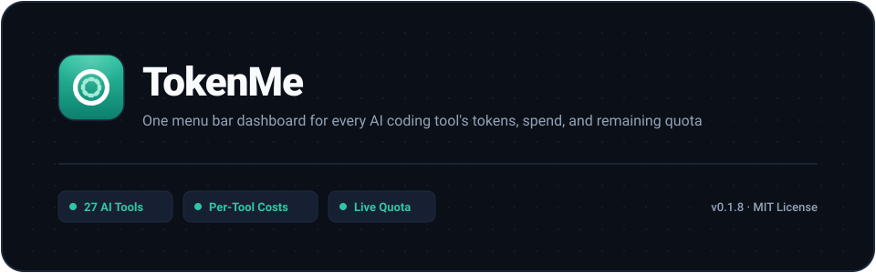
</p>

<p align="center">
  <a href="https://github.com/Bencibr/tokenme"></a>
  <a href="https://www.rust-lang.org/"></a>
  
  
</p>

<p align="center">
  <b>One menu bar dashboard for 27 AI coding tools — token usage, spend, and remaining quota from a local, read-only index. Stop checking each vendor's console.</b>
</p>

<p align="center">
  <b>English</b> | <a href="README.md">简体中文</a>
</p>

## What is TokenMe?

TokenMe is a menu bar app that tracks token usage, spend, and subscription quota across the AI coding tools you already run. Native installers for macOS and Windows, a fully static Linux collector and CLI. It answers three questions that usually have no good home:

- How many tokens did I burn today, and what did they cost?
- How much is left on each subscription, and when does it reset?
- Which tool owns this month's spend — and how much did caching actually save me?

Those numbers normally live in each vendor's own console and local logs, and none of them speak the same language. TokenMe reads the logs and databases your tools already write to disk and folds them into one local index; headless servers and containers run the collector and report home on a schedule, rolling every machine into the same ledger. Quota probes read each vendor's own API or local credentials — read-only — and the five tools with daily check-in can claim right from the panel.

## What can TokenMe do?

Working across Claude Code, Codex, ZCode and the rest, this tends to happen:

- You want to know what today cost, so you open three vendor consoles — and their numbers don't agree.
- A 5-hour rolling window runs dry right when the work is hottest.
- Points, credits, dollar windows — every subscription ships its own dashboard, and none of them talk to each other.
- At month's end you want the per-tool breakdown, and the only way to get it is parsing logs by hand.

TokenMe puts all of it in one panel, a click away — usage, spend, quota, check-in and speed on one screen, with servers and containers rolled into the same ledger.

## Screenshots

<p align="center">
  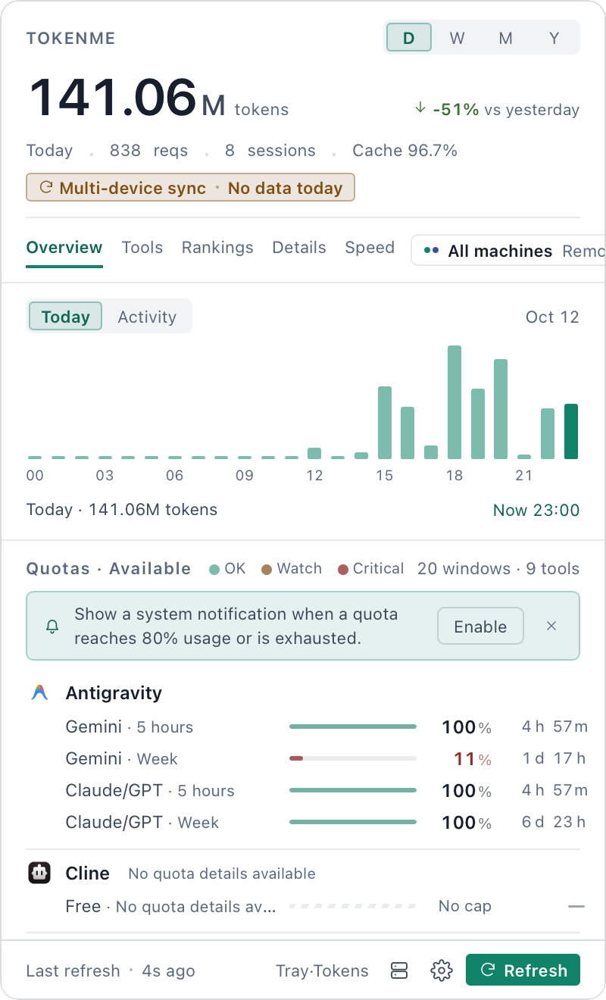
  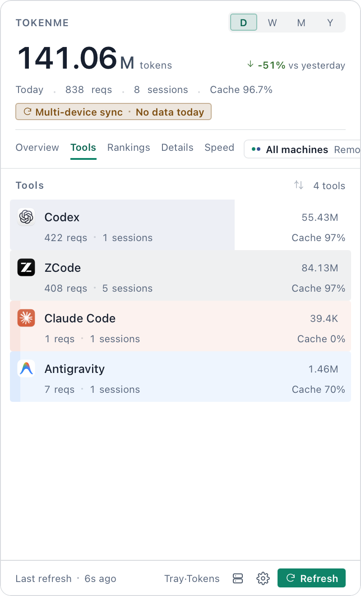
  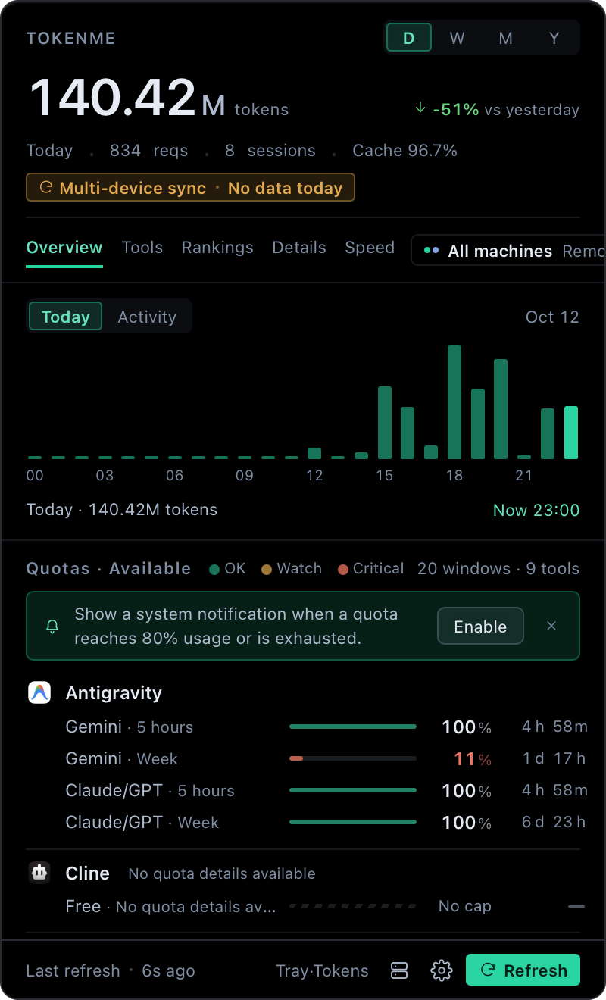
  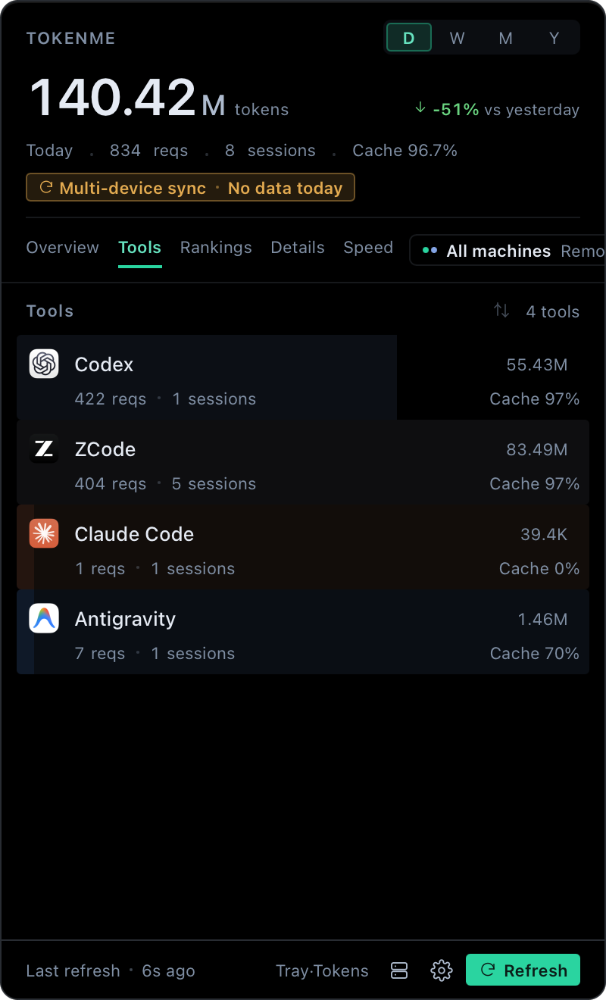
</p>

## Core features

The panel opens with five pages, each one drilling deeper:

- **Overview** — today's tokens, spend, and cache hit rate; an hour-by-hour usage chart; an Activity tab with a GitHub-style year heatmap (swipe for last week, last month, last year). Below, each vendor's quota bar with remaining share and reset countdown — tools with daily check-in claim right from the row header; and a native banner when a window crosses 80% used or runs out. Thresholds, and which vendors are asked at all, are settings.
- **Speed** — passive TTFT and TPS measurement, plus one-shot active probes for Codex and Claude Code.
- **Tools** — one row per tool: requests, sessions, tokens, cache rate — tinted with each tool's own app icon.
- **Rankings** — sessions ranked, so the expensive ones surface immediately.
- **Details** — per-request records, filterable by model and project.

The UI follows the system language: English and Chinese. Costs are converted, not billed — token counts times the [models.dev](https://models.dev) price list. It won't match a vendor invoice to the cent, but it answers where the money went and whether it was well spent. The index handles hundreds of thousands of events, builds in seconds, and each incremental scan after that takes tens of milliseconds.

## Install

Pick your platform: [macOS](#macos) · [Windows](#windows) · [Linux](#linux) · [Build from source](#build-from-source)

### macOS

**Homebrew (recommended)** — tap once, then short names:

```bash
brew tap Bencibr/tokenme https://github.com/Bencibr/homebrew-tokenme
brew trust bencibr/tokenme        # once — brew 6 asks before trusting third-party casks
brew install --cask tokenme       # the menu-bar panel
brew install tokenme-cli          # the CLI
```

The tap is bumped automatically on every release, so `brew upgrade` keeps you current, and cask installs carry no quarantine flag — Gatekeeper never steps in.

**Manual DMG**: grab it from [Releases](https://github.com/Bencibr/tokenme/releases/latest) and drag to Applications. The bundle is ad-hoc signed (no developer certificate), so Gatekeeper may step in — right-click → Open works, or clear the quarantine flag:

```bash
sudo xattr -rd com.apple.quarantine /Applications/TokenMe.app
```

### Windows

Grab the setup from [Releases](https://github.com/Bencibr/tokenme/releases/latest). The installer supports an all-users install: on shared machines choose **All users**, and use the same mode for upgrades — the machine-wide installation is then replaced in place for every Windows account. The setup also installs the `tokenme` CLI and adds its `bin` directory to the user PATH (Only me) or system PATH (All users). Open a new terminal after installation to use `tokenme --help`, `tokenme daily`, and `tokenme quota`. Upgrades do not duplicate the PATH entry; uninstall removes only this installation's entry.

### Linux

No menu-bar panel here — but Linux is a first-class collector: a fully static binary (musl, `x86_64` / `aarch64`, no glibc to align, no Rust or Python on the box). Grab the tarball from [Releases](https://github.com/Bencibr/tokenme/releases/latest) (`install-linux.sh` rides inside):

```bash
tar xzf tokenme-cli-*-linux-musl.tar.gz
cd tokenme-cli-*-linux-musl
./install-linux.sh --every 15 --push you@display-host
```

One command puts `tokenme` in `~/.local/bin` and wires up scheduled reporting. The panel's **Servers** entry can also do the ssh half for you — probes the host, pins the fingerprint, deploys the collector, pulls and merges on schedule. Details in the [user guide](docs/USER_GUIDE.md) §4.

### Build from source

```bash
git clone https://github.com/Bencibr/tokenme.git
cd tokenme
cargo install --path crates/usage-cli --bin tokenme   # the CLI
./scripts/build-macos.sh                              # the macOS panel
```

Once it's in, run a detection pass and look at the last week:

```bash
tokenme detect          # find every installed tool and where its logs live
tokenme daily --days 7  # the last week's daily usage and spend
tokenme quota           # live quotas and reset countdowns
```

## The CLI

When the panel stays closed, the CLI reads the same index:

```text
$ tokenme daily --days 3

┌────────────┬──────────┬──────────┬────────┬────────────┬────────┬────────┬─────────┬────────┐
│ Day        │ sessions │ requests │  input │ cache read │ output │  total │    cost │ cached │
├────────────┼──────────┼──────────┼────────┼────────────┼────────┼────────┼─────────┼────────┤
│ 2026-09-25 │      216 │   12,900 │  56.2M │      1.68B │   4.5M │  1.74B │  $99.15 │  96.8% │
│ 2026-09-26 │       45 │    4,592 │  30.5M │      704.9M │   1.8M │ 737.1M │  $54.53 │  95.9% │
│ 2026-09-27 │        6 │    2,534 │  25.1M │      377.1M │   1.1M │ 403.4M │  $46.49 │  93.8% │
├────────────┼──────────┼──────────┼────────┼────────────┼────────┼────────┼─────────┼────────┤
│ total      │      256 │   20,026 │ 111.8M │      2.76B │   7.4M │  2.88B │ $200.18 │  96.1% │
└────────────┴──────────┴──────────┴────────┴────────────┴────────┴────────┴─────────┴────────┘
```

| Command | What it does |
| :--- | :--- |
| `tokenme daily --days 30` | Day-by-day throughput, cache rate, and cost |
| `tokenme report --window week --group model` | One window, broken down every which way |
| `tokenme quota` | Live quotas with reset countdowns |
| `tokenme budget set zcode --monthly 50` | Put a monthly cap on a tool that has none |
| `tokenme export` / `tokenme import` | Ship a window of the index to another machine and merge it back — file-based, idempotent, no accounts |
| `tokenme pricing explain <model>` | Audit where a price comes from |

## Supported tools & live quota

Every tool below ships as a built-in adapter — 27 of them, indexed straight from the logs and databases each one writes to disk. Quota probes read credentials and never log you in; check-in, token renewal and the pause-on-exit behavior are detailed in the [user guide](docs/USER_GUIDE.md):

| Tool | Live quota | Check-in | Fixtures | macOS | Windows |
| :--- | :--- | :--- | :--- | :--- | :--- |
|  **Claude Code** | official 5-hour / cycle windows | — | ✅ | ✅ | ⏳ |
|  **Codex** | ChatGPT rate windows | — | ✅ | ✅ | ✅ |
|  **OpenCode** | OpenCode Go, three dollar windows (official provider only) | — | ✅ | ✅ | ⏳ |
| 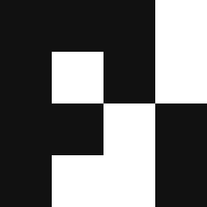 **Pi** | — | — | ✅ | ✅ | ⏳ |
| 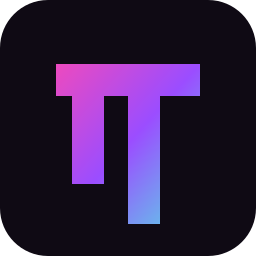 **Oh My Pi** | — | — | ✅ | ✅ | ⏳ |
|  **Cline** | account window limits | — | ✅ | ✅ | ✅ |
|  **ZCode** | 5-hour / cycle windows + session budgets | — | ✅ | ✅ | ✅ |
|  **Qoder** | subscription windows | ✅ | ✅ | ✅ | ⏳ |
|  **Qoder CN** | credits + plan / resource packs | ✅ | ✅ | ⏳ | ✅ |
|  **Antigravity** | self-computed (CLI `/usage`) | — | ✅ | ✅ | ⏳ |
|  **AgnesCode** | membership points (one-time token) | — | ✅ | ✅ | ✅ |
|  **AtomCode** | CodingPlan quota | — | ✅ | ✅ | ⏳ |
|  **WorkBuddy AI** (international) | member points | — | ✅ | ✅ | ✅ |
|  **WorkBuddy** (China) | credit-pack quota | ✅ | ✅ | ⏳ | ✅ |
|  **CodeBuddy** | Craft credits | — | ✅ | — | ✅ |
|  **Hermes** | — | — | ✅ | ✅ | ⏳ |
| 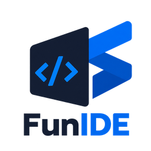 **FunIDE** | GLM-plan points | — | ✅ | ✅ | ⏳ |
|  **妙手** (formerly CatPaw) | points balance | — | ✅ | ✅ | ✅ |
|  **DSH** | DeepSeek account balance | — | ✅ | ✅ | ✅ |
|  **Crow5** | — | — | ✅ | ✅ | ⏳ |
| **Mimocode** | — | — | ✅ | ✅ | ⏳ |
|  **Cola** | plan quota | — | ✅ | ✅ | ⏳ |
| 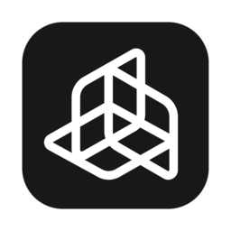 **JoyCode** | IDE points | — | ✅ | ✅ | ⏳ |
| 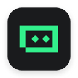 **Trae** | subscription quota | — | ✅ | ✅ | ⏳ |
|  **Trae CN** | subscription quota (per credit pack) | ✅ | ✅ | ✅ | ⏳ |
| 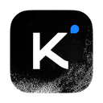 **Kimi Code** | 5-hour / weekly / monthly quotas | — | ✅ | ✅ | ✅ |
|  **MiniMax Code** | 5-hour / weekly quotas + points balance | ✅ | ✅ | ✅ | ✅ |

> **Fixtures**: every adapter carries a fixture test suite, run in full on CI for each commit, and every integration was verified against a real machine's data before it landed.
>
> **Verified on**: updated as real-machine verification progresses. ⏳ means the paths are implemented but not yet exercised on that platform.

OpenCode quota supports the official provider only. TokenMe reads `OPENCODE_API_KEY`, `provider.<id>.options.apiKey` from `$XDG_CONFIG_HOME/opencode/opencode.json` or `~/.config/opencode/opencode.json` when `baseURL` is `https://opencode.ai/zen/go/v1`, and finally API entries in `~/.local/share/opencode/auth.json`. Custom proxy providers are ignored.
>
> Quota-only sources: **Copilot** (premium-request allowance, official backend) probes quota only and indexes no usage; probing for **Gemini CLI** is deliberately off — its on-disk OAuth token was measured expired, freshening it would mean posting with the client id and secret embedded in the Gemini CLI's own bundle, and no project id for that call exists on disk (`crates/usage-quota/src/providers/gemini.rs`).

> **AgnesCode token**: its login token lives only in the app's memory and can't be read silently. Sign in at agnescode.agnes-ai.cn, copy the `access_token` request header, and write it to `agnes.token` in tokenme's OS config directory (`~/Library/Application Support/tokenme/agnes.token` on macOS, `~/.config/tokenme/agnes.token` on Linux, `%APPDATA%\tokenme\agnes.token` on Windows) — or set `AGNES_TOKEN`.

## TTFT & TPS measurements

TokenMe can passively measure **TTFT** (time to first token) and **TPS** (generated tokens per second) from local client activity. These are observed client-side timings, not provider benchmarks. Collection begins when enabled; earlier activity is not backfilled.

| Host | Passive measurements | User-triggered test |
| :--- | :--- | :--- |
| **Codex** | Turn-level TTFT from local Codex rollout streams; TPS when the stream provides output-token and timing data | Yes — one short request through the Codex CLI app-server |
| **Claude Code CLI** | Request-level TTFT and TPS from Claude Code OpenTelemetry spans; first-content timing is labeled separately and is not TTFT | Yes — one short CLI request with temporary, process-scoped telemetry |
| **DSH (DeepSeek Harness)** | Request-level TTFT and TPS from local compressed session logs, when the stream contains first-token timestamps | No — passive collection only |

DSH follows its session stats: TTFT averaged per request, TPS as output tokens over decode time; older logs without first-token timestamps yield neither. An active test sends one short prompt only after you click (uses plan quota), is kept separate from passive averages, and retains no prompt or response text.


## What's new in 0.1.7

- **New**: passive TTFT/TPS measurements for Codex, Claude Code and DSH; DSH results now aggregate by session using its output-weighted TPS formula. Optional one-shot speed tests are available for Codex and Claude Code.
- **New**: Qoder CN as a separate usage and quota adapter, with credit-pack windows and daily check-in.

## What's new in 0.1.6

- **New**: desktop pet skins (water drop / animated kitten / cute hanfu girl / cute hanfu boy / modern cute girl / summer long-legged beauty — blinking, pointer-following pupils, edge poses, token badge on hover); the summer skin preserves tall adult proportions, with display size and eye anchors defined in its JSON skin package; the pet registry now also supports lazy-loaded GLB/VRM model skins with JSON camera/head-tracking settings and a 2D fallback; the kitten's top pose was redesigned as a compact downward-looking peek; daily check-in for Trae, Trae CN and Qoder, done only after the vendor confirms; a separate Trae CN adapter with per-credit-pack windows; settings split into General / Alerts / Advanced / About with per-tool quota switches and auto check-in.
- **Verified**: WorkBuddy and Cline on real Windows machines.
- **Fixed**: Windows tray clicks, panel show/hide, borderless surface and bubble lifecycle — the invisible-panel and residual-surface regressions.

## Data & privacy

Only counts get indexed, never content — your code and prompts are not stored. What lands in the index is each request's token counts, model name, and project path. Scanning is read-only throughout; no telemetry, no third-party proxies. The index lives in your system data directory (`~/Library/Application Support/tokenme/` on macOS), and each tool's log paths are listed in the [user guide](docs/USER_GUIDE.md).

Multi-machine roll-ups move data over your own channels too — ssh/scp, or the one-click **Servers** entry in the panel footer — no accounts, no cloud; details in the [user guide](docs/USER_GUIDE.md) §4.

## Community

| | |
| :--- | :--- |
| Bug reports | [GitHub Issues](https://github.com/Bencibr/tokenme/issues) |
| WeChat user group |  |
| Email | Panel → Settings → Contact us (address in `apps/tokenme-bar/src/lib/about.ts`) |

## License

Released under the [MIT](LICENSE) license.

Full reference: **[docs/COMMANDS_EN.md](docs/COMMANDS_EN.md)** · Task guides: **[docs/USER_GUIDE_EN.md](docs/USER_GUIDE_EN.md)** · Architecture: **[docs/ARCHITECTURE_EN.md](docs/ARCHITECTURE_EN.md)**
