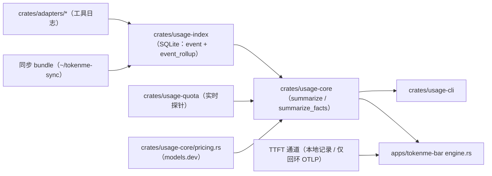

# TokenMe 架构

> 版本：0.1.8 · 更新：2026-10-13 · 读者：贡献者 · [English](ARCHITECTURE_EN.md)

## 一段话总览

每款受支持的 AI 工具都把日志写在自己本机；TokenMe 在「统计用量」这件事上从不与厂商通信。每工具一个适配器把各自的日志归一成同一种 `UsageEvent`，增量 SQLite 索引负责摄取（字节游标、去重键、保留期），`usage-core` 把事件折算成金额与时间窗——既可以在内存里全量算，也可以读索引自己维护的 `event_rollup` 缓存。两个前端——CLI（macOS、Linux、Windows）与菜单栏面板（macOS、Windows）——从同一个索引渲染同一批数字。服务器与容器上的用量经同步 bundle 并入同一索引（每个来源一个机器视图）；TTFT/速度是第二条独立信号通道，默认关闭，开了也只采本机。

## Crate 地图

| Crate | 职责 |
| :--- | :--- |
| `crates/usage-core` | 共享契约：`UsageEvent`/`TokenCounts`、计价（models.dev 优先级）、报表聚合（内存 `summarize` 与 rollup 折叠 `summarize_facts` 逐字共享 `merge_quotas`）、预算、`MachineScope` |
| `crates/usage-index` | SQLite 增量索引：文件游标、去重、摄取租约、保留期、watcher；维护 `event_rollup` 缓存表并承载报表读路径（`report_facts`）；同步协议 `export_sync`/`import_sync` |
| `crates/usage-quota` | 实时厂商配额探针（一个 provider 一个文件），共享一个 5 分钟 TTL、每工具一份缓存文件；每日签到与令牌续期也在这里；`copilot` 与 `gemini` 是纯探针，没有用量适配器 |
| `crates/adapters/<tool>` | 21 个工具族 crate，注册表共 28 个工具；7 个兄弟产品复用既有 crate 的解析器（crow5、mimocode 寄在 `opencode`，cola、omp 寄在 `pi`，qoder_cn 寄在 `qoder`，workbuddy_cn 寄在 `workbuddy`，trae_cn 寄在 `trae`） |
| `crates/adapters/all` | 注册表：`TOOL_IDS`、`detect_all`、`builtin_adapters`，外加编译期交叉核对——四个源码家的版本号与编译版本一致、`latest.json` 自洽（可以滞后，不许串版）、面板 `TOOL_ORDER` 不漏工具、CHANGELOG 每个已发布版本有分节 |
| `crates/usage-cli` | `tokenme` CLI：`detect` / `daily` / `weekly` / `monthly` / `report` / `sessions` / `quota` / `index --rebuild|--prune|--force` / `export` / `import` / `budget` / `pricing` / `icons`，外加 `dsh-doctor`、`codex-doctor`、`workbuddy-login` |
| `apps/tokenme-bar` | Tauri 2 菜单栏面板（前端 `src/`，Rust 在 `src-tauri/`）：概览/工具/排行/明细/速度五页，服务器与设置浮层，托盘，桌宠 |

## 数据流

面板的引擎线程独占索引；webview 从不直接碰它——每轮 pass 之后，引擎把序列化的 `Report` 经 Tauri 事件发出去。报表带作用域（全部机器 / 本机 / 单一来源）：作用域在折叠层过滤，而配额行无论作用域如何都只来自本机。

面板的报表读路径走 rollup：`usage-index` 维护 `event_rollup`——按（本地日，工具，会话，项目，模型，计量器）一组一行，约 39 万事件的索引折成约 2.2k 行——`Index::report_facts` 一次调用给齐：完整天读 rollup、今天的半天读活切片，外加最近会话与调用。若读时发现 rollup 空而 `event` 非空（升级后首次发布就是这种形态），先自愈重建再回答。内存路径 `summarize` 保留给 CLI 与测试；两条路折叠配额用的是同一个 `merge_quotas`，而 `facts.rs` 的黄金对账测试逐字段钉死两条路相等——谁也不可能跟谁对不上数。

这个循环是被监督的：panic 或意外返回会连同原因写进 `panel.log`，并以封顶退避重启——菜单栏应用一旦停止发布，画面只会安静地停在旧数字上，没有别的征兆。页面自己也报年龄：报表老过五个 cadence（下限五分钟）就在页头显示「数据已停止更新」。cadence 时钟归自己管：文件唤醒只把截止期往近了收，从不往后推，忙碌的日志目录饿不死周期 pass（修复前实测两轮 pass 的间隔被拖到 25–237 秒）。

冷启动的次序保证面板不等它不需要的工作。引擎只开 schema，先把上一轮自己的报表发出去——它在每次发布时镜像到 `<数据目录>/tokenme/report.json`，重新上屏要过 `snapshot::accept` 的诚实门（同作用域、同本地日、一小时以内、时钟没被动过）——然后才扫描任何东西；`Index::verify_integrity`（读全文件的 `PRAGMA quick_check`，170 MB 索引热态 0.4 秒、冷态 3.6 秒）排在首次发布之后、首次写入之前，损坏的库照样在每次启动时隔离重建，但永远不挡在屏幕前面。CLI 把这个检查紧跟在打开之后：它是诊断入口，不是渲染路径。页面这一侧，`index.html` 自带一块绘制前启动壳（与应用加载卡同款标记，配色镜像自上次应用的主题），因为 WebKit 会把未绘制的视图合成一张平板——而「等页面报告了再开窗」替代不了它：本机实测，从不被排到前面的窗口加载页面要 3.5–4.3 秒而不是 1.1–1.6 秒，等待本身会制造它所等待的延迟。`panel.log` 打印预算（`boot: … restore/detect/pricing/index open/has-events/sources/report`，以及 `the page reported content N ms after launch`），慢在哪儿是量出来的，不是吵出来的。

## TTFT 与速度（默认关闭）

被动采样只读本地记录：Codex 的 rollout 完成记录、DSH 的本地压缩会话流；Claude Code 走一个只绑定回环的 OTLP/HTTP JSON 接收器（端口 4319）——启用时把 trace 环境变量合并进用户的 Claude 设置，停用时只删除自己写入且未被动过的键。主动测速是一次性的：只在显式点击后发一条固定的短 prompt（Codex 走临时只读 app-server 线程，Claude Code 用每进程 OTLP 设置，DSH 由自家 CLI 计时），prompt、响应、凭据、主动测速结果一律不落盘。速度只采本机：作用域切到某台远程来源时，速度页会明说，并请用户切回「本机」或「全部机器」。

## 关键不变量

- **增量、绝不重读**：适配器返回字节/行游标，索引从上一轮停下的地方精确续读；文件缩短时先清掉自己那份过期行。
- **幂等摄取**：事件带稳定去重键，重放日志绝不重复计数。
- **一索引、多读者**：摄取租约（claim + TTL，`--force` 可抢）把并发 pass 串行化。
- **钱住在 usage-core**：CLI 与面板不可能对一个数字各执一词。
- **门禁抑制请求、不抑制答案**：`settings.json` 经 `usage_quota::collect_gated(budget, gate)` 决定哪些探针发请求；被门挡下的探针是跳过而非删除，缓存照读——把某家关掉，屏幕上留下的是它最后一次的答案。这也是为什么拨动这些开关刻意不触发刷新（强制 pass 会把用户刚刚选择保留的答案扔掉）。横幅同构：`notify::Gate` 只过滤**投递**，窗口的记录档位照常推进，所以解除静音不会补发静音期间越过的线。设置页渲染的探针清单来自 `usage_quota::inventory()`——注册表描述自己（哪些探针存在、哪些有宿主进程映射、哪些在本机拿到过答案），不是前端手抄的一份。
- **宿主退出即暂停**：工具的宿主进程不在了（精确进程名匹配，不是子串），探针就停发请求、保留最后答案；没有宿主映射的四个探针（`copilot`、`gemini`、`kimicode`、`minimaxcode`）从不受此暂停。
- **同步合并幂等**：同一 bundle 重放多少次都只算一次；行按导出时打上的 origin 分组成机器视图；删掉一台服务器只停拉取，已合并的行留在索引里。
- **每轮摄取留审计线索**：`logs/scan.log`（每轮有变更的 pass 一行 JSON，至多每小时一条心跳）记录每个工具走了哪些根（自动标出可疑的重叠对）、各轮计数与按工具拆分——「扫描器是不是重复计数了」靠用户发来的一个文件就能回答。
- **保留期**约束索引体量；`--prune` 丢弃更早的事件。

## 测试约定

每个适配器自带 fixture 驱动的测试（fixture 已匿名——没有真实会话数据），外加一条对账测试：适配器的数字必须与一次独立 SQL 重算一致。索引测试覆盖冷摄取、续读、并行摄取对账与损坏路径：`Index::open` 是廉价句柄，`Index::verify_integrity` 是整库守卫——把损坏的库连同它的 `-wal`/`-shm` 一起挪到一边（重建不能继承它们），交回一个空库给下一轮摄取重新填。注册表自检：`adapters/all` 在版本号各处漂移、`latest.json` 写出与编译树不符的安装包名或哈希、面板 `TOOL_ORDER` 漏掉工具、CHANGELOG 缺当前编译版本的分节时，直接让构建失败。面板的 Rust 是独立 workspace——根目录的 `cargo test --workspace` 看不见它，`apps/tokenme-bar/src-tauri` 下要再跑一次。服务器 e2e 挂 `#[ignore]`，需要真实 sshd 目标，只有 `cargo test --ignored` 会跑。

## 发布与分发

版本号住五个家，必须一起动：根 `Cargo.toml`（`[workspace.package]`）、面板 `Cargo.toml`、`tauri.conf.json`、`latest.json`、`apps/tokenme-bar/package.json`；`scripts/release.sh x.y.z` 负责前四个并打 tag（package.json 手动改）。产物按平台分家：GitHub Actions（`release.yml`，tag 触发）构建 macOS 应用 zip 与 DMG、三架构的 Linux musl CLI 压缩包，并更新 Homebrew tap（`tokenme` cask 是面板，`tokenme-cli` formula 是 CLI）；Windows 安装器挂在 Gitea release（私有 forge）上，经 API 手工附上去、正文带 sha256。Windows 安装器自带 CLI 并管理 PATH（「只为我」加用户 PATH，「所有用户」加系统 PATH）。
