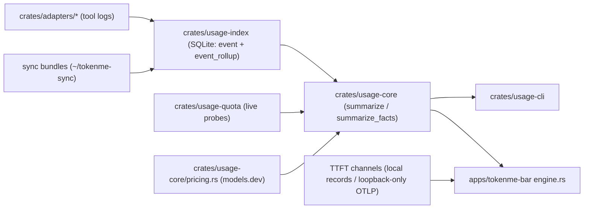

# TokenMe Architecture

> Version: 0.1.7 · Updated: 2026-10-12 · Audience: contributors · [中文](ARCHITECTURE.md)

## One-paragraph summary

Every supported AI tool writes its own local logs; TokenMe never talks to a vendor to *count* usage. Per-tool adapters normalise those logs into one `UsageEvent` shape, an incremental SQLite index ingests them (byte cursors, dedupe keys, retention), and `usage-core` folds events into money and windows — either fully in memory or from the index's own `event_rollup` cache. Two frontends — the CLI (macOS, Linux, Windows) and the menu-bar panel (macOS and Windows) — render the same numbers from the same index. Usage from servers and containers joins that index through sync bundles (one machine view per origin), and TTFT/speed is a second, independent signal channel that stays off until switched on and never leaves this machine.

## Crate map

| Crate | Responsibility |
| :--- | :--- |
| `crates/usage-core` | Shared contract: `UsageEvent`/`TokenCounts`, pricing (models.dev precedence), report aggregation (in-memory `summarize` and the rollup fold `summarize_facts` share `merge_quotas` verbatim), budgets, `MachineScope` |
| `crates/usage-index` | SQLite incremental index: file cursors, dedupe, ingest lease, retention, watcher; maintains the `event_rollup` cache and serves the report read path (`report_facts`); the sync protocol (`export_sync`/`import_sync`) |
| `crates/usage-quota` | Live vendor quota probes (one file per provider), one shared 5-minute TTL with one cache file per tool; daily check-in and token renewal live here too; `copilot` and `gemini` are probe-only — no usage adapter |
| `crates/adapters/<tool>` | 20 crates for the 27 registered tools; seven sibling products ride an existing crate's parser (crow5 and mimocode in `opencode`, cola and omp in `pi`, qoder_cn in `qoder`, workbuddy_cn in `workbuddy`, trae_cn in `trae`) |
| `crates/adapters/all` | Registry: `TOOL_IDS`, `detect_all`, `builtin_adapters` — plus compile-time cross-checks: the four source homes agree with the compiled version, `latest.json` is self-consistent (it may lag, it may not mix releases), the panel's `TOOL_ORDER` misses nothing, CHANGELOG has a section per released version |
| `crates/usage-cli` | The `tokenme` CLI: `detect` / `daily` / `weekly` / `monthly` / `report` / `sessions` / `quota` / `index --rebuild|--prune|--force` / `export` / `import` / `budget` / `pricing` / `icons`, plus `dsh-doctor`, `codex-doctor`, `workbuddy-login` |
| `apps/tokenme-bar` | Tauri 2 menu-bar panel (frontend `src/`, Rust in `src-tauri/`): overview/tools/ranking/detail/speed pages, the servers and settings sheets, the tray, the desktop pet |

## Data flow

The engine thread in the panel owns the index; the webview never touches it directly — the engine publishes a serialised `Report` over a Tauri event after every pass. The report carries a scope (all machines / this machine / one origin): scope filters at the fold, and quota rows are always this machine's whatever the scope.

The panel's report read path goes through the rollup: `usage-index` maintains `event_rollup` — one row per (local day, tool, session, project, model, meter) group, ~2.2k rows for a ~390k-event index — and `Index::report_facts` answers in one call: rollup rows for complete days, live slices for today's partial day, plus the recent sessions and calls. If a read finds the rollup empty while `event` is not (the shape of the first publish after an upgrade), it rebuilds before answering. The in-memory `summarize` stays for the CLI and tests; both paths fold quotas through the same `merge_quotas`, and the golden parity tests in `facts.rs` pin the two reports equal field by field — the two can never disagree about a number.

That loop is supervised: a panic or an unexpected return is logged to `panel.log` with its reason and restarted with capped backoff, because a menu-bar app that stops publishing keeps rendering old numbers and gives no other sign. The panel itself states the age — a report older than five cadences (floored at five minutes) shows "Updates stopped" in the header. The cadence clock is its own: a file wake pulls the deadline closer, never pushes it out, so a busy log tree cannot starve the periodic pass (measured here at 25–237 s between passes before the fix).

Cold start is ordered so the panel never waits on work it does not need. The engine opens the index (schema only) and publishes the previous run's own report before scanning anything — mirrored to `<data dir>/tokenme/report.json` on every publish, re-admitted through `snapshot::accept`'s honesty gate (same scope, same local day, under an hour, clock not moved) — and only then runs `Index::verify_integrity`: the `PRAGMA quick_check` that reads every page (0.4 s warm, 3.6 s cold on a 170 MB index) sits after the first publish and before the first write, so a damaged database still gets quarantined and rebuilt at every launch, without ever standing in front of the screen. The CLI keeps the check immediately after open: it is a diagnostic entry point, not a render path. On the page side, `index.html` carries a pre-paint boot shell (the same markup as the app's loading card, its appearance mirrored from the last applied theme) because WebKit composites an unpainted view as a flat sheet — and the shell cannot be replaced by "wait to show the window until the page reports": measured here, a window that is never ordered front loads its page in 3.5–4.3 s instead of 1.1–1.6 s, so the wait would be caused by the waiting. `panel.log` prints the budget (`boot: … restore/detect/pricing/index open/has-events/sources/report`, and `the page reported content N ms after launch`) so a slow open is attributed rather than argued about.

## TTFT and speed (off by default)

Passive sampling reads local records only: Codex rollout completion records and DSH's local compressed session streams; Claude Code gets a loopback-only OTLP/HTTP JSON receiver (port 4319) — enabling merges the trace variables into the user's Claude settings, disabling removes only what TokenMe wrote, and only while it has not been touched since. Active checks are one-shot: a single fixed, short prompt fired only after an explicit click (Codex through an ephemeral read-only app-server thread, Claude Code with per-process OTLP settings, DSH timed by its own CLI), and nothing — prompt, response, credentials, active result — is persisted. Speed is this-machine only: under a remote origin's scope the speed page says so and asks to switch back to This machine or All machines.

## Key invariants

- **Incremental, never re-read**: adapters return a byte/row cursor; the index resumes exactly where the last pass stopped. A shrunken file purges its own stale rows first.
- **Idempotent ingestion**: events carry stable dedupe keys; replaying a log never double-counts.
- **One index, many readers**: an ingest lease (claim with TTL, steal with `--force`) keeps concurrent passes serialised.
- **Money lives in usage-core**: CLI and panel can never disagree about a number.
- **Gates suppress requests, never answers**: `settings.json` decides which probes fire through `usage_quota::collect_gated(budget, gate)`; a gated probe is skipped, not deleted, while its cache is still read — switching a vendor off leaves its last answer on screen. This is also why moving one of those switches deliberately does *not* trigger a refresh (a forced pass would discard the answer the user just chose to keep). Banners have the same shape: `notify::Gate` filters **delivery** only and still advances the window's recorded tier, so re-enabling cannot replay a crossing that happened while the user was quiet. The probe list the settings sheet renders comes from `usage_quota::inventory()` — the registry describing itself (which probes exist, which have a host-process mapping, which have answered on this machine), not a hand-maintained front-end copy.
- **Host exit means pause**: when a tool's host process is gone (exact process-name matching, not substrings), its probes stop firing and keep the last answer; the four probes with no host mapping (`copilot`, `gemini`, `kimicode`, `minimaxcode`) are never paused this way.
- **Sync merges are idempotent**: a bundle replayed any number of times counts once; rows group into machine views by the origin stamped at export; removing a server stops the fetching but keeps the merged rows.
- **Every ingest pass leaves an audit trail**: `logs/scan.log` (one JSON line per changed pass, a heartbeat at most once an hour) records the roots each tool walked (flagging suspect overlap pairs automatically), the per-pass counters and the per-tool splits — "did the scanner double-count?" is answerable from a single file a user can send over.
- **Retention** bounds the index; `--prune` drops older events.

## Testing conventions

Every adapter ships fixture-driven tests (fixtures are anonymised — no real session data), plus a parity test asserting the adapter's numbers match an independent SQL recomputation. Index tests cover cold ingest, resume, parallel ingest parity, and the corruption path: `Index::open` is the cheap handle, `Index::verify_integrity` is the whole-file guard that sets a damaged image aside (with its `-wal` and `-shm`, so a rebuild cannot inherit them) and hands back an empty one for the next ingest to refill. The registry tests itself: `adapters/all` fails the build when the version homes drift, when `latest.json` names an installer that does not match the compiled tree, when the panel's `TOOL_ORDER` forgets a tool, or when CHANGELOG lacks a section for the compiled version. The panel's Rust is its own workspace — `cargo test --workspace` at the root cannot see it; run `cargo test` under `apps/tokenme-bar/src-tauri` too. The server e2e sits behind `#[ignore]`, needs a live sshd target, and only `cargo test --ignored` runs it.

## Release and delivery

The version lives in five homes that must move together: the root `Cargo.toml` (`[workspace.package]`), the panel's `Cargo.toml`, `tauri.conf.json`, `latest.json`, and `apps/tokenme-bar/package.json`; `scripts/release.sh x.y.z` bumps the first four and tags (package.json is manual). Artifacts split by platform: GitHub Actions (`release.yml`, tag-triggered) builds the macOS app zip and DMG, the three-architecture Linux musl CLI tarballs, and updates the Homebrew tap (the `tokenme` cask is the panel, `tokenme-cli` the formula); the Windows installer rides the Gitea release (the private forge), attached by hand through the API with the sha256 in the body. The Windows installer bundles the CLI and manages PATH itself (user PATH for Only me, system PATH for All users).
