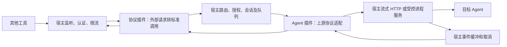

# Agent 网关插件扩展设计 0.1

日期：2026-10-20（Asia/Shanghai）。状态：新增需求的设计草案，未冻结、未实现、未做真实 Agent/客户端验收。本文是核心 0.5 的可选扩展，不能把这里的能力、字段或命令放进当前 alpha 包并声称可运行。

## 1. 当前结论与范围

**现有核心设计不支持将某个 Agent 直接代理给其他工具调用。** 已有 http.request 是出站的有界请求，process.invoke 最长 10 秒；它们没有入站监听、流式协议、长任务、调用方身份与会话隔离。新增网关需要宿主首次实现通用运行服务，此后在已实现的传输/能力范围内，通过安装插件增加 Agent 和接口适配，不再逐个修改核心。

默认场景是本机其他工具访问本机 TokenMe。本地网关属于运行平台，不要求新增云端后台。局域网、互联网服务、多用户托管、WebSocket 和双向实时音视频不在本扩展的首个交付范围；需要它们时新增传输 profile 和独立验收，不能把绑定地址改成 0.0.0.0 就视为支持。

“代理 Agent”分两种对外合同：

| provider_kind | 对外行为 | 判定依据 |
| --- | --- | --- |
| model_inference | 一次模型请求，按声明支持文本、流、客户端函数调用等特性 | 上游确实提供这些语义，映射有合同用例；不把完整 Agent 的工具轨迹伪装成模型增量 |
| agent_task | 创建/继续一项 Agent 工作，输出进度、审批、结果和用量 | 上游提供可识别任务/会话及执行控制；文件写入、执行程序等权限另授权 |

同一包可以注册两类 provider，也可以只提供其中一种。声明支持某种外部 API，不代表支持该 API 的全部模型、多模态、函数调用或会话语义。无法表达的字段/能力返回 FEATURE.UNSUPPORTED，不静默丢弃 system 消息、工具结果或参数。

用户已指定本机WorkBuddy供本机Claude Code使用，并要求评估两种方式。建议两者均纳入独立能力、先模型网关后任务委派，见[评估与委派研究](AGENT_MODES_EVALUATION.md)和[场景核验](WORKBUDDY_CLAUDE_CODE.md)。具体版本/国内国际版、机器接口、协议字段和SDK须在G01/WB-P0/WB-D0锁定，不因场景已指定就宣称上游已验证。

## 2. 宿主和插件的边界



| 扩展点/模块 | 插件声明和实现 | 宿主运行职责 |
| --- | --- | --- |
| gateway.protocol | 版本化协议 ID、路由模板、请求/事件/错误映射、支持特性 | HTTP 解析、认证先行、路由命名空间、响应发送、流量上限；不在核心写某个厂商的字段分支 |
| agent.invoke | provider、能力目录、上游端点/程序定义、认证来源、创建/读取/取消/核对协议 | 账号选择、授权句柄、资源预算、任务状态、强制取消；不让插件直接持有监听 socket |
| 会话/数据 | 上游会话标识解释、用量来源/请求标识、状态映射 | 调用方隔离、Ref 映射、generation fencing、标准事实接收和审计 |
| 设置/品牌/通知 | provider 图标、名称、国际化、设置描述和标准事件 | 统一页面、全局与应用覆盖、健康和通知门控；与配额等已有机制联动 |

协议插件和 Agent 插件可以同包，也可分别安装复用。宿主建立明确的 endpoint→protocol→provider 绑定，不允许插件任意同步互调；原有依赖 DAG/因果深度上限仍生效。认证发生在任何 guest 解析之前。协议插件不接收调用密钥、上游凭据或未经允许的请求头。

## 3. 包注册、协议与项目结构

拟新增扩展 profile tokenme.gateway/0.1，生成独立版本的 manifest/schema/WIT/SDK/TestKit。沿用 Rust→Wasm Component→包的路线；基础包的签名、信任、品牌、语言资源和安装流程复用核心合同。扩展会新增字段/枚举/宿主服务，须声明最低宿主与扩展 profile；旧宿主拒绝必需扩展，不把未知字段当兼容。具体生成合同在 G01 冻结，当前生产 v1 与 alpha 都不接受以下拟议注册区块。

| 拟议注册块 | 必需内容 |
| --- | --- |
| gateway.protocols[] | id/version、decode/encode handler、route_ids；每路由的 method、相对模板、输入/输出 schema、request 或 stream 模式 |
| agent.providers[] | id、tool_id、kind、handler_id、features、model_catalog、resource_ids、auth_definition_id、supported_platforms |
| gateway.endpointDefinitions[] | id、protocol_ref、provider_ref、默认关闭、允许 features；不指定任意监听地址/上游 URL |

routes 在宿主分配的 endpoint 前缀下唯一。允许 GET/POST/DELETE，禁止 CONNECT、绝对 URL、路径穿越和任意通配代理；有副作用的注册操作必须显式分类。路由前缀与凭据分别管理，前缀不可猜测也不替代认证。客户端用宿主显示的 Base URL、独立访问密钥和已授权模型/provider ID 配置连接。

provider 的 features 是严格布尔集合：text、streaming、client_tools、agent_execution、session_resume、cancel、usage、reconcile；首个 profile 仅文本模态，包含需正式定义的结构化工具块，不支持附件/图像。kind=model_inference 时 agent_execution=false；client_tools 的语义只生成/接收客户端函数调用。特性是上限，实际允许值还与 endpoint、consumer、账号及宿主已实现能力取交集。

建议作者目录（待 G01/F09 工具生成；不是当前存在的 CLI 命令）：

```text
plugins/<publisher>/<agent>/
  plugin.json                     # Agent/provider、资源、设置、语言与可选协议
  Cargo.toml / Cargo.lock
  src/lib.rs                      # 有限步执行、上游事件映射
  assets/                         # 图标与语言资源
  fixtures/                       # 合成流、取消、重试、工具调用和用量样本
  tests/                          # SDK/TestKit 合同与故障用例
  README.md / LICENSE
```

不随包投放任意可执行 helper。原生 CLI 作为明确的外部依赖，由宿主识别安装、校验版本/程序身份并显示缺失原因；只有经授权的受控进程服务可启动。程序版本不支持则 provider unavailable，不自动下载执行。构建、验证、打包、签名复用同一个作者工具链，G01/F09 扩展模板和场景矩阵。

## 4. 标准调用、会话与事件

拟议 GatewayContext 与普通采集 TaskContext 分开生成。它绑定 endpoint_ref、consumer_ref、request_ref、session_ref、provider_ref、account_ref、plugin/digest/generation、execution/grant revision、trace、截止期及剩余预算，身份全部由宿主填写。协议插件不能通过外部 body 指定真实账号、工作目录、凭据、授权或其他 consumer。request 触发源由宿主签发，不伪装成用户手动 action。

| 记录 | 规范要求 |
| --- | --- |
| AgentRequest | kind、provider_ref、model_id?、session_ref?、messages、tools、tool_results、options；引用必须属于当前调用授权。每个未知字段拒绝，禁止自由透传扩展对象 |
| Message | 有序的 system 块与 user/assistant 内容块分别保存；内容为 text/client_tool_call/client_tool_result 的闭合 union，工具块绑定 call_ref；具体全量字段在 G01 随协议生成，不能用 Message.text 平铺工具历史或从正文修改权限 |
| ClientTool | name、description、受限 JSON schema；数量≤32、单 schema≤16KiB、深度≤8，不含可执行程序/工作目录配置 |
| ToolResult | 当前 session 已发出的 call_ref 和 text；最多一个终态结果，重复相同内容 no-op，不同内容冲突 |
| RequestOptions | max_output_tokens?、temperature?、timeout_ms?；具体范围由 G01 及 provider 目录交集固定，未支持选项拒绝 |
| AgentEvent | request_ref、session_ref、seq、kind、payload；kind=start/text_delta/client_tool_call/approval_required/progress/usage/terminal；tagged union，不接收任意其他事件 |
| Terminal | state=succeeded/failed/cancelled/outcome_unknown、finish_reason=stop/max_output/client_tools/error/cancelled/outcome_unknown、结构化 error?、usage_status=known/partial/unknown；一个 request 至多一个终态；state/reason 必须相容 |

model_inference 只允许 start/text_delta/client_tool_call/usage/terminal，结束原因须保留；agent_task 可增加 progress/approval_required。内部进度/审批不直接混进模型文本。自由文本是业务载荷，只进入当前授权流，不进入日志、普通诊断、索引或通知文案。

会话键至少含 profile/endpoint/consumer/provider/account；映射到上游 session/任务的 Ref 仅宿主内部可解析。外部 session ID 即使被另一个工具取得，未通过上述归属检查也拒绝读取/继续/取消。默认新会话，不自动复用 IDE 当前窗口/默认对话；只有用户明确选择、上游提供隔离和恢复语义才可绑定已有会话。重启后未证实可恢复的任务标 outcome_unknown，不能凭本地残存会话 ID重放。

model_inference 的一次请求可在 client_tool_call 后以 finish_reason=client_tools 结束，后续工具结果作为同一 consumer/session 的新 request 校验；agent_task 若声明客户端工具支持，可以进入 awaiting_client_tool 后继续原任务。G01 必须分别定义其请求/调用关联，不能把两种模式共用一个自动续跑策略。所有 tool_results 校验已登记 call_ref 与单次消费状态，未请求的调用和跨 consumer 回填拒绝。

允许函数调用时，由 Agent 返回结构化 call_ref/name/arguments_json，arguments 最大64KiB，校验声明 schema 后再返回客户端。客户端执行其工具并回传结果；TokenMe 不自动执行这些函数。agent_task 自主执行文件/命令属于独立 agent_execution 授权，见第 8 节。

## 5. 长任务和宿主流式服务

原有采集的 10/30 秒任务限制继续有效。网关通过短步执行与宿主持有的长 IO 会话实现，不让 guest 在 execute 中维持无限事件循环或长驻后台：

1. 宿主接受并落库 request/lease，调用 handler 的 start。
2. guest 请求明确上游的流/进程句柄，返回有界状态和等待目标；宿主进行 IO。
3. IO 就绪后以 step 重新实例化/执行 guest，输入有界 chunk、已校验的私有 continuation，产出标准事件和下一步指令。每个 request 同时仅一个 step，seq 由宿主分配；新 Store 不依赖 guest 全局变量。
4. 宿主在标准事件接收、协议编码和外发前重新验证归属、generation、grants、截止期与预算，提供背压。
5. cancel/reconcile 也使用已注册 handler；guest 故障时宿主仍能关闭网络、终止其受控进程树并回收资源。

新增服务拟为 http.stream.open/read/close 和 process.session.open/read/write/close。open 仅接受已授权 endpoint_id/program_id 与结构化参数；后续只接受本 request 的 handle。流式 HTTP 延续 TLS、DNS/重定向逐跳授权、端点/凭据绑定，不能退化为客户端提供任意 URL 的代理。进程以参数数组/固定 cwd/最小环境启动，正文经约定 stdin 输入，无 shell；原始 stdout/stderr 只是有界协议输入，不进入正式日志。需要 TTY、屏幕注入或没有稳定机器输出合同的 CLI 不列入首发支持。

WorkBuddy需要本机长连接时，须broker.session.open/read/write/close，传输区分本机HTTP/SSE和原生pipe/socket。端点发现/进程及文件归属、认证/证明、原生句柄取消和帧上限由宿主执行，操作/帧协议由插件声明。握手sessionToken由宿主捕获为不透明句柄，不传给协议插件/consumer；不能把短时broker.request冒充流服务，也不放宽普通HTTP的private/loopback默认拒绝规则。具体合同由WB-P0/WB-D0证据纳入G01/G03。

传输 heartbeat 与 Agent 业务事件分开；协议插件可声明有界 heartbeat 定时编码，由宿主驱动，不另起 guest 后台循环。ping 可保持客户端流活跃，但不推进业务 idle 计时、不增加 Token/成功计数，也不延长硬 deadline。协议块/工具参数增量及结束事件必须按选定协议在 G01 定义，当前概念事件表不足以直接宣布 Claude Code 可用。

gateway.protocol handler 只绑定 context、时钟和受限元数据日志；agent.invoke 只额外绑定当前 request 的流/进程服务和不透明凭据获取。两者均不继承 source.read/facts.query/通用持久 state.cas/credential.exchange；配置为宿主提供的只读快照，刷新由独立 auth.refresh 调度。continuation 仅有界内存保存，不自动落盘；允许持久化的恢复标识必须是 G01 闭合 schema 的受保护元数据。否则“正文默认不保存”会被插件的通用私有状态写入绕过。

初始资源合同：每 step 最长2秒、fuel1000万、全部 guest memory64MiB、continuation≤64KiB；长 IO 不占用普通采集 runner。复用已校验编译缓存，不为每个文本 chunk 重编译模块。每 session 默认10分钟、硬上限30分钟、无业务进展90秒、排队最多30秒；这些是初始预算，G03/G07 实测不通过时修订，不能宣称性能已达标。

全局同时2个 Agent request，每 provider/账号1个，每 consumer1个；全局队列16、每 consumer2。每请求输入1MiB、标准事件/上游 frame64KiB、输出合计8MiB、未发送缓冲256KiB；大文本须分块，不能无限累积。超限明确拒绝/终止，不悄悄截断为成功。可暂停读取时先背压；持续5秒不可排空则取消、按实际证据决定 cancelled 或 outcome_unknown。原生进程树初始每请求1GiB、总2GiB；必须实测强制预算及子进程清理，Wasm 限制不等于 Agent 原生进程沙箱。

HostSupervisor 单独管理 gateway IO/进程配额，短步 runner 与已有调度共享有界执行池，并保留采集进度；不得让两个长 Agent 请求饿死今日报表、配额读取和 UI。G03 验证满队列、慢客户端、挂起上游、多插件、超大事件和 native 崩溃。

## 6. 调用状态、幂等、取消与恢复

request状态为accepted/queued/starting/running/awaiting_client_tool/awaiting_approval/awaiting_input/cancel_requested，终态为succeeded/failed/cancelled/outcome_unknown。状态变化与元数据outbox同事务，正文不自动持久化。model_inference客户端流断线默认取消，不代表上游已停止或不计费。agent_task的MCP控制连接断开不取消已经accepted的job，同一consumer可重新查询；显式取消/停用、deadline、宿主退出仍取消/核对。G01按kind固定差异，不共用“任何断线都取消”策略。

消费可能计费或产生文件副作用，**一旦可能发送到上游，默认不自动重新创建请求，也不自动切换账号/provider**。超时、网络断裂、接收丢失、runner/宿主崩溃和强杀均依据证据处理：尚未 dispatch 可以安全重试；上游有稳定幂等键/任务查询则只核对同一请求；否则 outcome_unknown。确认取消的 cancelled 不承诺撤销此前文件变更、已执行工具和已发生费用。

宿主在发送外部副作用前持久记录 dispatch_intent。崩溃可能发生在 intent 落库后、实际发送前；缺少上游可查询身份时仍按未知处理，以避免重复执行。取消等待最多5秒；无法证实上游停止则终态 outcome_unknown，并保留可核对的 task/operation Ref。明确证实尚未发送或上游已停止才标 cancelled。强制终止本地进程也不证明其已提交的远程任务取消成功。

提供幂等键的协议按 endpoint/consumer/provider/account/key 绑定内部规范请求摘要，保存24小时：相同键不同内容返回 GATEWAY.IDEMPOTENCY_CONFLICT；相同键同内容返回原 request 状态/引用，绝不再启动上游。首版流不支持重连重放；同键重试不能伪造丢失的 delta，返回 STREAM_NOT_RESUMABLE 及安全状态，不默默执行第二遍。无幂等键客户端的主动新请求可能产生新费用，UI 和诊断须可辨认。

同一 profile 只能有一个 GatewayOwner，持有原生进程身份、DB lease/fencing 和本地 IPC。桌面与 CLI 请求复用它；不能通过改端口绕过账号写互斥。失去 owner 时停止接收，未决 dispatch 先核对，不因租约到期自动重放。桌面退出时监听停止、任务取消；常驻后台须另交付显式 gateway serve 运行模式（拟议命令，当前不存在），由用户选择生命周期，不让插件自己脱离宿主常驻。

## 7. 入站认证与授权

默认关闭，用户启用 endpoint 后只绑定数字 loopback 127.0.0.1，可分别启用 ::1；不监听所有网卡。不依赖 localhost DNS 判断来源。Host/authority 须为实际绑定的数字地址与端口；拒绝不匹配 host、绝对形式代理请求、CONNECT 和未注册路由。网关访问密钥与上游账号凭据分别管理。

每个 consumer 生成独立随机32bytes密钥，宿主受保护存储中保存带盐摘要并常数时间验证；完整值仅创建时显示，不进入包、普通设置导出、日志和 URL/query。请求通过 Authorization header 认证后才解析业务 body/调用任何 guest。协议插件只见 consumer_ref 和允许的非秘密头；客户端的 Authorization 不转发给 Agent。撤销 key 立即停止新请求、取消该 consumer 的现有请求并按证据记录未知结果；轮换创建新 key、不静默复活旧 key。

ConsumerGrant 精确绑定 endpoint/provider/account、features、并发/频率和到期策略。路由选择账号来自 grant 与显式用户配置，不接受 body/header 中的任意 account_ref。模型目录只返回该 consumer 被允许且当前可用的 provider/model。不存在自动回退其他账号、国内/国外版或其他插件账号。

无 cookie 认证；首版不支持浏览器直接调用，带 Origin 的请求和跨域预检拒绝，不默认开放 CORS。HTTP header 总量≤16KiB、个数≤64、单 body≤1MiB，认证和路由亦有超时；统一返回安全错误，不回显密钥、上游响应正文、CLI异常、真实路径或账号邮箱。LAN/TLS/mTLS、多用户身份属于独立 profile，未验收前设置页不暴露相应开关。

## 8. Agent 工具权限和凭据

三种权限分开：插件读取配额的授权、consumer 调用 Agent 的授权、Agent 执行本地/远程工作的授权。安装一个已有用量插件不自动创建可调用服务；启用网关也不自动给访问者 shell、任意目录、凭据导出或文件写入能力。

model_inference的client_tools只返回建议，执行在客户端。agent_task的agent_execution默认关闭，需要明确工作范围、工具类别及审批方式。受限workspace模式由宿主/OS/上游已验证策略真正强制，不能靠提示词或cwd替代。另可声明trusted_agent执行模式，用户授予明确的完整Agent执行范围后才启用；它不标为文件沙箱/只读。Wasm外壳不隔离外部Agent二进制，未提供相应真实权限边界/授权的模式unavailable。

approval_required 的确认只能来自绑定的宿主 UI/已授权控制面，并绑定 consumer/session/action/输入摘要和有效期；普通消息或协议插件构造 approved=true 不构成审批。审批等待不绕过总 deadline，拒绝/过期执行取消规则。无法往外部协议安全映射审批时，拒绝该执行模式；不能使用自动同意一切的 CLI 参数补齐兼容性。

上游凭据仍由宿主认证服务注入获准端点/程序，不回传给外部工具。刷新与已有 auth.refresh 合同一致，不能因一次代理请求无限刷新/更换账号。首发仅选择提供可核验 API/机器接口的 Agent；某产品登录凭据可读或现有 quota 插件能工作，不构成其模型调用、Agent执行或对外服务能力的证据。

## 9. 用量、设置、通知与问题定位

Agent一次工作可能产生多次模型请求。只按明确语义接收per-call/session-cumulative用量，保留model、来源、partial/final；缺失Token是unknown，不拿字符数冒充实测。提示词、文件内容、函数参数和delta默认只在有界内存传递，不自动保存对话历史/日志。model_inference终止即释放正文；agent_task为agent_result保留终态后1小时的最终结果内存缓冲，单job≤8MiB、每consumer≤16MiB、全局≤64MiB。达到预算明确result_unavailable或拒绝新接收，不回空文本冒充成功结果；重启后不能安全重新获取的正文标unavailable。持久化结果另需显式保存策略，首版默认不落盘。必要的上游恢复标识受保护，非当前未决任务24小时内清理。

优先以真实上游 request ID关联现有日志的 contribution，接入核心去重和来源优先级。同一上游调用经代理和本地日志出现，只能计一次。缺少稳定关联或可证明不重叠的覆盖范围时，保存 gateway_usage_observations、标记 overlap_unknown，展示代理侧观测但暂不叠加公共今日总数；不能编造 vendor_request ID让重复数据看似唯一。由 G05 提供真实代理→本地日志→索引→汇总对账证据。

vendor_cost、估算 Token/燃值、TTFT、TPS 延续各自来源和测量口径；费用不因请求失败或客户端断线自动归零。本地预算能确定限制请求数、并发、时间和输出字节；没有上游硬额度/可靠实时计量时，不承诺金额或 Token 预算能绝对阻止超支。

设置分为宿主总开关、endpoint、provider、账号和 consumer 授权；具体 provider 开关、图标、文案由插件注册，密钥由宿主专用控制面管理。通知复用全局与应用覆盖：不可用、需登录、请求失败/未知、额度预警、任务完成都要声明标准事件和本地化键，不能把提示词/结果正文塞进通知。通知关闭不停止请求，网关关闭会停止接收并取消任务，配额轮询关闭不隐式关闭已明确授权的网关。

元数据记录 endpoint_ref/consumer_ref/request_ref/session_ref/provider_ref、包版本/generation、trace、阶段、排队/首事件/结束耗时、字节数、错误码、用量来源、新鲜度、取消/核对状态。普通日志/导出不记录正文、header、完整URL/真实路径、密钥、上游账号/会话原文或它们的摘要。诊断能回答“请求在哪个阶段失败、上游是否可能执行、为何未重试、是否计入今日总数”。健康 UI 逐层显示监听、协议、provider、账号、程序版本、授权和最近请求，不把已监听当作 Agent 可用。

持久化新增 gateway_endpoints、gateway_consumers、gateway_grants、gateway_requests、gateway_sessions、gateway_usage_observations；复用核心 installs/grants/outbox/lease。request 状态及幂等绑定至少24小时，诊断元数据默认7天且有大小上限；过期不改变已接收标准事实。数据库里不存业务正文/密钥明文。用量事实及 receipt 按核心索引规则保留，不随卸载或清理诊断删除。

## 10. 升级、停用和故障边界

endpoint 绑定精确 protocol/provider 包摘要及 generation。升级先停止该路由接收、请求取消并记录未决，再原子切换注册与授权版本；不把旧 session/continuation 自动交给新组件。不能取消的远程工作保留未知/核对记录，阻止同 key 重启；新组件无兼容核对处理器时提示人工核对。旧包仅为未决任务的受控核对保留，不再接受普通请求，撤销信任的包也不得借此继续执行。

停用/卸载 protocol 或 provider 立即撤销对应路由；其他插件与采集继续。故障不删除已有用量/配额缓存。主机休眠、网络重连、程序退出、凭据变化和权限撤销触发同一取消/核对状态机；不重放错过的网络流/请求。不支持持久事件重放的外部协议不得宣称会话断线无损恢复。

## 11. 开发票与验收

实施规格新增可选 F13 轨道；它依赖通用核心，但不阻塞 F11.2 全量适配迁移。下面 G 票尚未完成，不把现有 alpha/reference 或设计模型通过当作验收。

| 票 | 交付/位置 | 前置 | 完成条件 |
| --- | --- | --- | --- |
| G01 合同/SDK | spec/plugin/gateway、usage-plugin-api/sdk/testkit 的扩展 profile；请求/事件/路由/授权/状态 schema、WIT、模板和黄金流 | F01；各模式WB-P0步骤1—2/WB-D0协议证据 | 同步/流、错误/取消、工具/审批、未知字段/不支持特性有正反样例，旧宿主明确拒绝扩展；A/B可分批冻结 |
| G02 接入/身份 | usage-plugin-host/gateway：listener、routes、consumer/key/grant、模型目录 | G01/F02/F04/F05 | 先认证后 guest、数字loopback、域名重绑定/Origin拒绝、key撤销、consumer隔离、超限和唯一owner实测 |
| G03 长运行监督 | gateway supervisor、runtime短步/事件流、native进程/HTTP stream及经验证需要的broker session服务 | G01/F03/F04/F05 | 慢客户端背压、原生内存/树取消、deadline/并发/公平性、崩溃与未知状态、退出无孤儿进程实测 |
| G04 协议与Provider | A：Anthropic Messages协议＋WorkBuddy model_inference；B：MCP工具协议＋WorkBuddy agent_task | G02/G03；各模式WB-P0步骤1—2/WB-D0 | A执行WB-P0步骤3—5；B按WB-D1—D3，分别冻结/验收，不要求同时可用 |
| G05 用量与恢复 | usage-index接收、gateway请求/会话/usage表、幂等与核对 | G03/F06/F10 | 请求中断不假零、重复不双计、多模型/累计修正、无ID重叠、dispatch崩溃矩阵有对账证据 |
| G06 控制面/作者工具 | 网关标准页面、品牌/语言/设置/通知/诊断、模板/build/pack扩展 | G02/G03/F07/F08/F09 | 开关和权限效果可解释，插件声明能动态显示，秘密不导出，包可独立安装/升级/停用 |
| G07 真实垂直验收 | 指定外部工具→TokenMe→指定Agent→事件/用量/取消 | G04/G05/G06 | 真实安装包、真实客户端和Agent、账号隔离、工具授权、故障/取消/升级、真实用量对账；平台分别留证据 |

对抗场景必须包含：访问者A读写B会话；无key/恶意Origin触发任务；上游不支持工具却被声明兼容；Agent已执行但响应丢失；同key不同正文；取消后上游继续；宿主崩溃在dispatch两侧；慢消费者撑爆内存；会话长占饿死配额任务；重启/升级重放；日志和代理用量双计；原生Agent越过workspace；关闭通知误取消Agent；关闭代理误清空用量。只有实际服务/组件/OS/客户端链路的证据能通过相应验收。

## 12. 当前交付状态

本次交付边界、合同草案、开发拆分和对抗验收输入。已明确WorkBuddy→Claude Code的A模型网关/B任务委派需求并给出建议；真实接口资格和全量生成合同仍待冻结，没有提供可运行代理/委派插件或访问URL。不能描述为“已支持任意Agent反代”或“全部文档设计闭环”。
