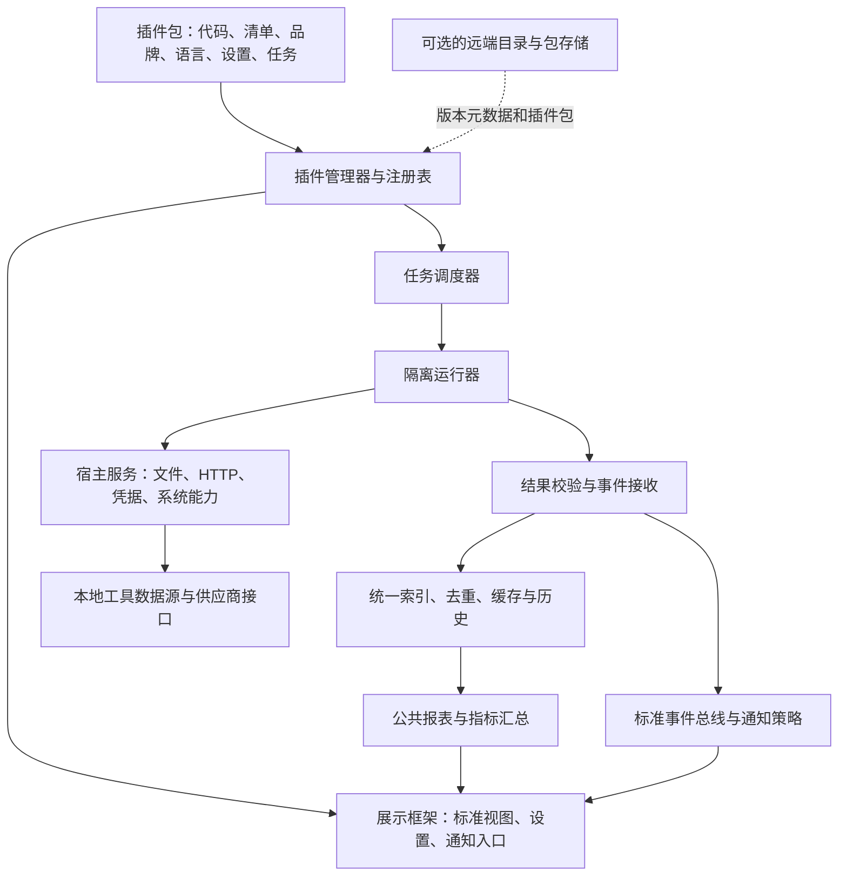

# TokenMe 插件平台改造方案

版本：0.5（第二轮对抗审计后的设计输入）
日期：2026-10-20（Asia/Shanghai）
状态：产品边界已确认；首条路线固定为 Rust/Wasm，提供独立可执行参考工程。生产 TokenMe 接入仍按实施票验收。
基线：`e1cf55d2a86c7ff668d2c1dacbcefc961b8b16d6`；开发分支：`plug`。
文档属性：可审查的设计草案，随 plug 分支提交。内部工作副本、本机审计记录及构建产物另存于忽略目录；本文不声明生产平台已实现。

实施入口：[实施规格 0.5](IMPLEMENTATION_SPEC.md)、[可运行参考工程](../../prototypes/plugin-platform-v1/README.md)。生产语义见[主合同](PRODUCTION_CONTRACTS.md)与[0.5 补充合同](DESIGN_HARDENING.md)，复核见[第二轮对抗审计](AUDIT_ROUND2.md)和[迁移清册](MIGRATION_INVENTORY.md)。[首轮审计](AUDIT.md)保留历史证据。配套：[日志与定位](LOGGING_DIAGNOSTICS.md)、[语言与 SDK](LANGUAGE_AND_SDK.md)。当前 alpha 仍以参考代码为准；[早期示意](examples/README.md)不可安装。完整生产协议须在 F01 生成全部 schema/WIT/SDK 后冻结，不用设计 review 通过代替。

新增需求见[Agent网关扩展](AGENT_GATEWAY.md)：用户指定[WorkBuddy→Claude Code](WORKBUDDY_CLAUDE_CODE.md)的模型API网关和完整任务委派两种方式。建议两者独立注册、先网关后委派，详见[模式评估/委派研究](AGENT_MODES_EVALUATION.md)。核心0.5出站HTTP/短时程序调用不足，新增可选F13/G01—G07及WB-D探路票，先增加通用接入/长连接/任务服务。调用方向已明确；真实接口资格/全量生成合同仍待冻结，不能宣称已支持。

## 1. 目标与已确认决策

TokenMe 提供展示框架、本地运行平台、统一数据与汇总系统。工具相关的数据源识别、认证协议、接口路径、采集解析、估算、签到、品牌、通知规则、语言资源和专属设置，由可独立安装的插件提供。

验收场景：框架构建完成后，安装一个框架此前不认识的工具插件；不修改框架源码、不重新构建应用，就能识别它的名称、图标、配色、配置项和声明的能力，运行任务，将结果接入标准卡片、通知和今日汇总。

已确认的产品边界：

| 决策 | 方案 |
| --- | --- |
| 第三方插件 | 支持本地包安装，明确标识发布者、来源和授权范围 |
| 现有能力 | 逐步迁为预装的官方插件；支持独立升级、停用和卸载 |
| 首版 UI | 以声明式标准组件、设置描述和主题令牌为主；为隔离的自定义视图保留扩展接口 |
| 首版分发 | 本地插件包、预装包与更新来源协议；在线市场后续接入 |
| 后端 | 本地运行平台属于本次核心；云端发布、审核和目录平台不作为前置条件 |
| 通用汇总 | 今日总量、模型排行、跨工具报表由框架按统一口径计算与展示 |
| 可扩展性 | 工具插件及可复用的估算、价格、指标等能力插件都使用版本化扩展点；新增 Agent/协议插件按独立网关扩展 profile 实施 |

协议覆盖桌面、CLI 和服务器采集器，按实际支持的平台分别验收。设计覆盖不等于全部环境已经验证。

首版不包含：在线市场和付费体系、云端保管供应商凭据、任意原生动态库加载、任意前端脚本注入、所有开发语言的运行时、插件之间任意代码互调。

## 2. 当前代码与改造切面

以下路径相对仓库根，依据本次隔离分支的基线核对。统计数量不作为设计依据，以运行时注册表为准。

| 当前切面 | 当前实现位置 | 改造方向 |
| --- | --- | --- |
| 用量源发现和增量读取 | `crates/usage-core/src/adapter.rs` 的 `SourceAdapter`、`ReadOutcome` | 保留摄取语义，增加协议边界和动态适配代理 |
| 静态适配器注册 | `crates/adapters/all/src/lib.rs` 的 `TOOL_IDS`、`builtin_adapters` | 迁入统一 `PluginRegistry`；过渡桥接最终退出生产路径 |
| 配额探针和缓存 | `crates/usage-quota/src/lib.rs` 的 `QuotaProbe`、`collect_gated` | 用注册任务和标准配额结果替代工具静态列表 |
| 签到注册和开关 | 同文件 `CHECKIN_TOOLS`、`manual_checkin`；面板 `settings.rs` | 签到与配额读取分离注册，保留显式开关和副作用边界 |
| 事件与报表 | `crates/usage-core/src/types.rs`、`report.rs` | 标准事件兼容扩展；标准聚合仍由框架执行 |
| 周期估算和工具特例 | `crates/usage-index/src/facts.rs`、`crates/usage-core/src/pricing.rs` | 工具策略通过能力接口注入，公共聚合机制保留在框架 |
| 面板调度 | `apps/tokenme-bar/src-tauri/src/engine.rs` | 接入任务调度器，保持首屏、缓存和发布节奏 |
| 图标、名称与排序 | `crates/usage-core/src/icons.rs`、前端 `ToolIcon.tsx`、`lib/format.ts` | 读取注册元数据；缺失插件时采用历史快照和通用回退 |
| 通知与语言 | 面板 `notify.rs`、`src/lib/i18n.ts` | 规则和插件文案来自插件，系统投递和公共文案由宿主维护 |
| 日志与问题定位 | `crates/usage-quota/src/diagnostics.rs`、`crates/usage-core/src/adapter.rs`、面板 `logging.rs` / `diagnostics.rs` | 结构化事件、插件/任务/请求关联、健康页、脱敏诊断包及只读排查接口 |
| 设置与调用 | 面板 `settings.rs`、`commands.rs`、`bridge.ts` | 标准设置 schema 和通用 action；新增工具无需新增专属 Tauri command |
| CLI、同步与采集器 | `usage-cli`、`usage-device-sync`、`usage-index/src/sync.rs` | 共用注册和数据协议；延续各同步入口及既有身份语义 |

复杂能力不能只靠 HTTP 配置覆盖：当前代码有 SQLite/WAL 读取、Windows DPAPI、客户端凭据轮换写回、锁协议、本地 broker 和受控 CLI 调用。原型必须验证这些代表性能力，不能只完成一个固定 JSON 接口就宣布可全面迁移。

## 3. 总体架构



本地后端默认运行在现有桌面/CLI 的后端生命周期中，不要求新建公网服务，也不默认开放本地 TCP 管理端口。需要独立运行器时使用经过目标平台验证的私有 IPC，消息有界、身份绑定，不复用设备同步网络接口。

框架拥有统一状态、任务授权、事件接收、索引写入和汇总；插件只通过 SDK 与这些服务交互。插件不直接写核心数据库、不直接控制系统通知、不向公共报表追加未经校验的总数。

关闭窗口与退出进程需要区分。首版保持现有进程生命周期；需要退出面板后仍持续执行时，再复用同一运行库增加受管理的本地常驻入口。电脑关机后的任务需要另一个持续在线、具备相应数据与授权的节点，不能仅靠分发后台完成。

## 4. 模块边界与实施目录

以下为待实施结构，不代表这些目录已经存在：

```text
crates/
  usage-plugin-api/       协议、清单、身份、能力、任务与结果类型
  usage-plugin-host/      注册、包管理、授权、调度、宿主服务、事件与诊断
  usage-plugin-runtime/   唯一选定的首版执行引擎及运行器
  usage-plugin-sdk/       插件作者 SDK、测试支持及绑定生成
  usage-plugin-testkit/   匿名 fixtures、模拟宿主服务和合同/故障验证
  usage-core/            公共数据口径、通用聚合、报表与格式基础
  usage-index/           索引、事务、游标、去重、查询与迁移
plugins/
  official/<tool>/       官方插件源码、清单、资源、匿名 fixtures
apps/tokenme-bar/src/
  plugins/               元数据、标准视图、设置和插件管理 UI
spec/plugin/             经原型验证后发布的协议、schema 与兼容样例
tools/tokenme-plugin/    开发脚手架、检查、构建、调试与打包工具
```

职责方向为 SDK → API、宿主 → API/运行时/索引，核心数据层不依赖具体插件实现。生产框架最终不再链接每个工具的适配 crate。

过渡期允许一个明确标记的官方 legacy bridge 复用现有逻辑来做对账；它只用于迁移，不能作为第三方安装机制，也不能替代“从包加载代码”的最终验收。

## 5. 首条运行路线与上线验证门

### 5.1 共同要求

- 用户无需自行安装 Node.js、Python、Rust 或 Wasm 工具链。
- 清单加插件代码；纯配置可以使用 SDK 提供的通用处理器，复杂逻辑实现同一能力接口。
- 不在主 WebView 执行业务代码；不把任意 DLL/so/dylib 作为公共插件 ABI。
- 插件代码只能通过授权的宿主服务访问外部资源；宿主调用本身也必须有截止期、大小限制和取消路径。
- CPU、内存、输出、并发和日志均有上限；一个任务故障不能拖住公共报表发布。
- 插件与框架、协议、SDK 分别版本化；能力协商早于任务调度。

### 5.2 固定的首条执行路线

| 选择 | 当前交付 | 上线前仍需验证 |
| --- | --- | --- |
| Rust 1.98.1 → wasm32-wasip2，WIT + Wasmtime 49.0.0 | 独立 workspace、Rust SDK、组件、参考宿主、检查/测试/构建/打包/安装工具 | 复杂 OS 服务、真实供应商和主程序集成、全局资源预算/取消、各平台与首屏成本 |
| TypeScript 语言适配 | 后续里程碑，不属于当前 alpha 支持清单 | 同一协议的组件化构建、体积/启动成本、异步/取消和调试合同 |

实施者现在按固定路线开展开发，不再自行选择运行时。若实测无法满足上线预算，另写 ADR 修订路线和 SDK 合同；首阶段不并行维护第二种生产引擎。

Rust SDK 首发、TypeScript SDK 分阶段接入。TS 可通过转 JS 再组件化的路径验证同一 Wasm 宿主，不等于增加生产 JS 引擎。详细开发步骤见 [实施规格](IMPLEMENTATION_SPEC.md)，后续完整 SDK 范围见 [SDK 规范](LANGUAGE_AND_SDK.md)。

独立进程用于故障隔离，不能单独当作权限沙箱；沙箱来自受限执行引擎、受控导入和宿主授权检查的组合。原生调用留在可信宿主服务中，每次携带插件身份、任务实例、账号和授权句柄。

Wasmtime 提供 fuel/epoch 中断机制，参考宿主已同时使用；它们不替宿主取消无界文件、网络或子进程操作。Wasm 机器码缓存只由本机可信编译产生，不接受第三方预编译缓存。第一版只维护已选定引擎；原先的 JS 引擎候选不再作为实施分支。

### 5.3 P1 选型输出

记录同一设备、同一匿名样本上的：冷启动到首份内容、首次插件加载、热态增量扫描耗时、峰值工作集、安装包大小、连续任务稳定性。先测基线，再为每项提交可复核的回归预算；当前方案不编造毫秒、内存或包体积结论。

必须完成日志增量、SQLite/WAL、Windows 系统凭据服务和一个带写回/状态核对的任务样例。其他操作系统的构建与运行分别记录；未实测的平台不标为已支持。

## 6. 插件包与清单协议

### 6.1 包结构

扩展名固定 `.tokenme-plugin`，内容为受约束的归档包：

```text
manifest.json
dist/plugin.wasm
assets/icon.svg
i18n/en.json
i18n/zh-CN.json
build-info.json                  # 设置/视图定义内嵌清单
checksums.json
signature.json                   # 未签名本地包需明确标识其信任状态
LICENSE
```

安装器先校验路径、大小、文件类型、清单和资源，再在隔离的暂存目录验证，成功后原子切换启用版本。拒绝路径穿越、归档符号链接越界、重复覆盖和解压膨胀。摘要用于完整性；发布者身份依赖可信签名和信任根，不能把包内自声明的 `official` 字段当作官方认证。

一个包可以声明多个明确的工具身份；官方迁移优先一工具一包，国内外版本独立 ID 和运行状态。共享解析代码优先在构建时复用，首版不引入任意插件间的运行依赖图。可复用策略通过版本化能力接口发布，消费者显式选择实现；该接口采用同样的授权和结果校验。

生产清单的完整区块和升级方式以生产合同第 2 节为准；alpha 已实现的区块以其 schema 为准。构建元数据记录 SDK/工具链/来源及模块摘要，打包需匹配成功构建凭据；来源验证仍依赖签名与可信构建流程。

同目录 `examples/manifest.json` 和语言文件是早期合成产品示意，不是当前 alpha schema。当前可构建、可打包样板在 `prototypes/plugin-platform-v1/reference-plugin/`，具备真正编译的模块。两套示例均不代表 Devin 或真实供应商接口；实施必须使用参考工程中的实际 schema。

### 6.2 能力注册

| 扩展点（生产合同） | 输入 | 输出 |
| --- | --- | --- |
| `source.detect` | 允许的根、环境标识、已有发现快照 | 工具存在性、来源和账号引用 |
| `auth.discover` | tool scope、获准的认证来源定义 | 候选 hint，由宿主确认后登记账号；不返回明文秘密 |
| `auth.refresh` | account scope、凭据维护授权和旧 revision | 独立 credential_write、CAS 和结果未知核对，不隐藏在 quota.read 内 |
| `usage.collect` | 来源句柄、游标、时间范围、批次上限 | 用量事实、下一游标、来源修订和诊断 |
| `quota.read` | 账号引用、配额配置、凭据句柄 | 配额窗口、原始单位、重置时间和新鲜度 |
| `checkin.run` | 账号、厂商周期、手动/自动原因、动作幂等标识 | 已领取/无可领/需登录/待核对/失败等结构化状态 |
| `metric.estimate.tokens` | 经授权的事实、配额窗口、模型和策略配置 | 带来源与算法版本的估算记录 |
| `metric.estimate.value` | 用量或估算、定价引用、币种与时间范围 | 可追溯燃值/价值估算，说明估算依据 |
| `pricing.resolve` | 模型、计量单位和时间范围 | 价格或换算方案、来源、有效期与版本 |
| `telemetry.observe` | 获准的数据源及观测配置 | TTFT/TPS 等带口径的被动测量 |
| `metric.read` | 获准 scope、范围及配置版本 | 已知单位/算子的指标；不自动进入公共汇总 |
| `action.run` | 注册 action、校验后的参数和用户操作上下文 | 结构化结果与标准事件 |

每个扩展点的类型、结果接收及服务见生产合同第 3—5 节；F01 将其生成到 spec/plugin/v1 并提供正反样例。v1 未知字段拒绝，不设任意扩展对象。新增框架无法表达的 OS 服务、指标算子或组件时，按协议演进发布宿主版本。

拟议 gateway.protocol/agent.invoke 及 endpoint/provider 注册不在上表当前核心能力内；它们由网关 G01 生成独立扩展合同，不能仅把能力名加进插件清单就执行。协议转换和 Agent 适配由插件提供，监听/调用认证/流式 IO/会话与取消由宿主提供。

## 7. 宿主服务与权限

| 服务 | 插件定义 | 宿主负责 |
| --- | --- | --- |
| 文件发现/读取 | 相对根、匹配规则、格式及读取策略 | 授权根解析、分页、有界读取、真实路径/重解析点校验和来源身份 |
| SQLite | 数据源和读取映射、查询参数 | 只读连接、WAL/快照一致性、有界查询；禁止 ATTACH/扩展加载/任意写入 |
| HTTP | origin、方法、路径模板、认证引用、解析器 | TLS、代理、重定向逐跳授权、超时、限流、响应上限和脱敏 |
| 本地 broker | 发现规则、握手协议与方法 | 绑定的连接句柄、来源归属验证和超时；不把 loopback 等同可信 |
| 凭据/系统加解密 | 来源、账号映射、认证/轮换协议 | 系统 API、限定句柄、凭据存储、跨任务互斥、审计和安全写回 |
| 受控程序调用 | 允许的程序身份、参数结构和输出格式 | 无 shell 拼接的参数传递、环境最小化、可执行路径校验、超时和输出限制 |
| 插件状态 | 命名空间中的状态键、schema 和迁移 | 插件/工具/账号隔离、事务、配额和原子写入 |
| 设置和通知 | schema、规则、语言键、action 引用 | 值校验、全局策略、系统投递和状态持久化 |

接口 origin 和路径规则属于插件；通用执行与授权属于宿主。供应商特有的路径、字段、刷新时机和锁流程不得继续散落为核心中的工具 ID 分支。框架提供通用原子替换、比较后写入、锁、系统解密等能力，插件组合成厂商协议。

默认以不透明凭据 handle 供绑定 HTTP 使用。standard-v1 不导出明文 secret、不写第一方登录；credential-maintenance-v1 只对明确目标/账号/endpoint 授权，由独立 auth.refresh/credential_write 任务维护，不把只读 quota 重试升级为隐式刷新。撤权使 handle 失效，第一方竞争/结果未知先核对，见补充合同 §5。

第三方插件不继承进程环境变量、任意用户目录、其他插件数据或核心数据库访问。官方签名表示来源，不表示可以绕过权限。插件市场下架信息只在客户端获取后生效，离线期间不承诺即时远程撤销。

## 8. 数据、身份与汇总合同

### 8.1 身份与归属

区分 `plugin_id`（代码包）、`tool_id`（产品）、`account_ref`（本地不透明账号）、`source_id`（采集源）、`occurrence_id`（一次真实发生）、`origin_device`（归属设备）、`plugin_version`（产生数据的实现）。名称、图标和翻译不参与身份。

兼容现有工具 ID，不因迁为插件重命名国内/国际产品。账号不以 token 原文命名，换 token 不更换账号身份。插件版本不进入事实去重键，否则升级会重算历史。

同一工具的多个插件不能静默抢占数据。按工具/账号/数据源维护活动实现和摄取租约；显式切换实现时先校验来源身份与游标兼容性，再交接。官方名称空间和替换关系由宿主管理。

设备归属与事实去重分开：同一供应商请求在两个设备或两个数据源出现，不应仅因设备不同就累计两次；若厂商请求 ID 仅局部唯一，则插件明确身份域。同步保持 occurrence 身份和原有 origin/epoch/stream 约束，不简单给去重键再加插件版本或机器名。

### 8.2 标准事实与扩展指标

- 增量用量：输入、缓存创建、缓存读取、输出四阶段互斥；reasoning 为 output 的拆分，不能重复相加。
- 计量单位属于事实，不仅属于工具。同一工具可同时有 Token 和原生 Credits；缺失 Token 不能用积分冒充。
- 同一请求的 Token、Credits、费用来源可以互补；它们不是多个真实请求。多源合并必须声明等价关系和优先级，不能盲目将两行各算一次。
- 累计计数必须先按来源语义还原增量，处理重置与修正，再进入统一汇总。
- 金额使用币种和十进制定点表示；原始事实不因动态价格表变化被覆盖。估算与价格快照另存来源、算法版本、有效时间和计算时间。
- 协议拒绝 NaN/Inf、负用量和超范围计数；精度与上限由 schema 明确。涉及 JS 时对安全整数范围和大计数的线格式单独验证，不在边界上静默截断或舍入。
- 配额窗口具有稳定 ID、单位、used/remaining 语义、重置时刻、采样时刻、状态和可信程度。未知、无限、未登录、暂时失败、禁用和真实 0 必须区分。
- 自定义指标声明单位、维度、时间语义及聚合方式（sum/latest/max/weighted 等宿主支持的算子）；百分比不作为跨厂商可直接相加的总量。
- 真实值与估算值分别汇总；估算携带输入事实引用、算法版本、覆盖范围和限制说明，不进入实际用量事实的重复加总。

### 8.3 写入、游标与历史

宿主校验有界批次及身份后，在同一事务提交事实、修订和下一游标；失败不推进游标。支持日志截断/替换、数据库 WAL 活动、迟到事件、来源修订、幂等重放和 rollup 修复。

自定义插件私有游标作为有版本、有大小上限的不透明数据保存，不能强制所有来源只有字节偏移。与现有 `ReadCursor` 的转换通过适配代理完成，兼容性经 fixtures 验证。

保留现有公共事实和报表模型作为首个兼容层，新增表/字段采用 additive 迁移。不要在第一步重写全部索引、报表与设备同步协议。

卸载或远端缺少插件时，已接受的标准事实继续可汇总。保存可安全渲染的品牌/名称/单位元数据快照，缺失插件时使用快照或通用图标；历史查看不依赖执行已卸载代码。

## 9. 任务调度与动作语义

每个任务注册：稳定任务 ID、能力与处理器、运行环境、账号范围、配置门、调度方式、截止期、并发键、资源预算、重试规则、副作用等级和错误分类。

触发方式覆盖定时、文件变化、手动操作和已注册事件；事件联动限制循环深度、频率及来源，并为一次因果链保留 trace。读取接口的路径匹配不默认意味着捕获工具的 HTTPS 流量；如需额外采集通道，应单独注册并授权。

`source.detect` 由注册后的发现生命周期调用并受同样预算约束；估算处理器通过显式任务绑定事实/配额变化，不能因声明一个函数就隐式获得持续运行权限。框架在接收并提交新状态后发布事件，重复结果不重复触发联动。

registered 是定义注册状态；invocation 使用 queued/running/succeeded/failed/gated/cancel_requested/cancelled/outcome_unknown。需要登录、平台不支持、关闭、网络失败分别展示，不统一为空数组或 0。发现阶段使用 tool scope，不要求尚未识别的 account/source。

有效执行权限由宿主全局策略、插件启用状态、账号授权、插件设置、宿主进程条件和运行预算共同决定。每种任务只受相关门控制：关闭配额轮询不应意外触发签到，启用签到也不能绕过签到自己的总开关。

保留当前原则：开关抑制新请求，保留最后一次结果及时间；设置切换不得隐式执行 `clear_cache` 或强制刷新。手动 action 只有协议明确允许时才绕过自动调度开关，且仍受授权、去重和资源限制。

读取任务可对临时错误做有界退避，遵循 Retry-After 和供应商限流。写操作使用账号/动作/厂商周期的幂等身份；超时且结果未知时先查询状态，不能盲目重发领取请求。跨进程通过租约协调，跨设备采用配置的任务归属策略；不承诺网络条件下通用的“恰好一次”。

日历任务显式声明厂商时区与周期边界，处理休眠恢复、断网和夏令时；补跑仅针对当前仍可执行的周期，不把过期的历史日程全部重放。禁用或升级期间，旧任务结果带 generation 校验，不能覆盖新版本状态。

采集 execution_revision、通知 notification_policy_revision、展示 presentation_revision 分离；改变通知阈值/主题不会丢弃合法用量批次。相同 batch ID 还须匹配 scope/payload 摘要；同 contribution 同 revision 不同数据整批拒绝。缺失 Token/时间、累计顺序和 pending 的线格式见补充合同 §2，不能由开发者默认为 0 或扫描时间。

## 10. 品牌、界面、设置、国际化和通知

### 10.1 展示合同

插件注册名称、图标、颜色令牌、深浅主题变体、指标绑定、卡片、明细表、操作和空/错/禁用状态。宿主提供 quota、metric、model-table、status、action、settings 等版本化组件和布局插槽。

颜色只影响命名空间内的品牌令牌，不允许覆盖全局任意 CSS。宿主负责可读性和主题回退。SVG 需安全处理，拒绝脚本、外部资源及主动内容；样例图标只是静态形状。

全局概览、今日总量、排行、公共时间/机器作用域和通用设置由框架渲染。插件专属细节由其视图定义提供，但不能自行覆盖全局总量。首版不提供任意 HTML/JS 执行，自定义视图将来在独立隔离边界和窄消息 API 下接入。

### 10.2 设置合同

设置注册稳定键、数据类型、默认值、作用域、语言键、校验、条件可见性、变更语义以及所控制的任务/通知/视图。支持布尔、枚举、数值、文本、路径选择和凭据引用；秘密值不能作为普通文本设置进入报表或同步。

设备专属路径与权限默认本机保存。非敏感设置是否同步由 schema 声明并由用户选择；同步不自动安装并执行插件，也不自动传播凭据。设置变更在执行边界生效，必要时取消或重启对应任务，避免旧结果写回。

### 10.3 国际化合同

插件拥有自己的语言目录和 key 命名空间；宿主保留框架公共文案。回退顺序为完整 locale → 同语言通用 locale → 插件默认语言 → 可见的通用回退。zh-CN 到 zh 的回退不应误匹配不同产品身份。

打包时校验语言键、占位符、引用可达性和资源路径。日期、数字、币种和单位由宿主 locale 格式化；跨设备传输事件码与结构化参数，而不是预先拼好的某种语言句子。通知模板和设置说明也遵守同一规则。

### 10.4 通知合同

插件注册结构化事件、条件、阈值默认值、多语言模板、严重程度和 action；宿主负责投递许可、全局与插件开关、免打扰、限频、去重和点击路由。

通知支持“全局统一设置 + 按应用单独设置”。应用默认跟随全局，可针对配额阈值、提醒开关、冷却和已支持投递方式覆盖；未覆盖字段继续继承，可一键恢复跟随。这里应用对应 tool_id，同插件下多个应用分别设置。全局通知总开关/免打扰始终优先；全局默认规则的修改只影响继承字段，不覆盖应用自定义。插件声明规则/schema/默认值，TokenMe 提供统一编辑、解析和投递。完整合同及验收见[生产合同 §7.1](PRODUCTION_CONTRACTS.md#71-通知的统一设置与按应用设置)。

继续保留 `notify::Gate` 的行为：被静音时仍推进已观察的状态，解除静音不补发旧阈值；系统投递失败按投递策略处理，不能与用户主动静音混为一谈。稳定窗口/账号/事件身份防止每次轮询重发。

严重档升级可绕过较轻档冷却；旧窗口/过期样本/历史导入不产生新告警。OS 通知与本地落盘不是同一事务，回执丢失为 delivery_unknown，不能自动重复投递。合法通知配置与当前平台是否实现/授权该通道分开；详见补充合同 §4。

## 11. 生命周期、更新与分发

安装流程：解析并验证 → 展示来源/权限/兼容性 → 授权 → 暂存加载自检 → 原子登记版本 → 注册能力 → 按门启动。授权属于产品运行流程，不意味着实现阶段每个可逆开发动作都需要再次确认。

升级流程：验证来源和新清单 → 检查新增权限 → 暂停新调度 → 收敛旧任务 → 备份需迁移的插件私有状态 → 在暂存区迁移/自检 → 原子切换 → 恢复。失败恢复到旧可用版本及兼容状态；不可逆迁移不能被笼统称作可自动回滚。宿主数据库迁移由宿主管理。

停用后释放监听器、连接、租约和定时器，最后数据保留并标明状态。卸载默认保留标准历史及最小显示快照，提供单独清理操作；凭据撤销与保留策略明确显示。

更新来源协议从第一版抽象：预装包、本地文件、可信目录。元数据包含插件/发布者身份、版本、摘要、签名、宿主兼容、平台、权限变化和撤回状态。签名只证明来源与完整性；权限控制仍在客户端。离线已安装插件继续运行，依赖供应商接口的任务仍需供应商网络。

第一阶段不实现市场后台。未来云端负责目录、上传、检查、审核、发布和撤回；需要时采用独立账号和后台权限。更新元数据的签名、过期与回滚保护可参考 TUF；当前文档不宣称已实现 TUF 或完整供应链验证。

## 12. 迁移策略与改造顺序

1. 建立协议、运行时与两个代表性样例，不同时重写全部适配器。
2. 接入动态注册表和标准代理，让现有索引/报表继续工作；官方 bridge 只承担迁移对账。
3. 对同一匿名数据跑旧实现和插件实现，比较标准事实、去重、游标、配额及报表。影子路径只允许纯读取；签到与凭据轮换使用模拟服务和独占执行，不能双跑真实写操作。
4. 迁移品牌、i18n、设置、通知和估算策略，清理前后端静态工具表及工具 ID 特例。
5. 按工具批次切换，维持现有身份、账号、数据和缓存迁移；每批单独提交与回退。
6. 所有生产工具从插件包加载后，移除 legacy bridge 和工具专属链接；预装插件由构建流程打包、启动时登记。

代表性顺序固定，随后执行全量清册：

| 批次 | 对象 | 证明内容 |
| --- | --- | --- |
| 合成参考插件 | `Example IDE` | 不改宿主即可安装新 ID、注册任务/设置/品牌/i18n、展示汇总和通知 |
| 简单真实插件 | Codex 的匿名日志通道 | 增量解析、模型映射、日志配额、历史对账；实时认证另按权限验证 |
| 复杂真实插件 | Qoder CN，另加 MiniMax 轮换模拟合同 | SQLite/WAL、原生 Credits、系统解密、签到语义、账号隔离、写回互斥 |
| 后续批次 | 其余官方适配器及公共策略 | 多平台来源、受控 CLI、broker、速度、价格/估算策略和设置迁移 |

Devin 只作为目标验收用例，不假设其 API、授权或数据路径已经核实。真正开发 Devin 插件前独立确认数据源；不得拿合成接口冒充实际适配。

F11.1 对应上表代表性样例，F11.2 承接[全量清册](MIGRATION_INVENTORY.md)中的其他 adapter、quota-only 产品及估算/价格/测速/品牌等策略；F12 依赖 F11.2 完成后才能关闭 legacy bridge。新字段/覆盖值升级不兼容时保留原值并提示，不静默重置为启用。

## 13. 阶段任务与完成条件

| 阶段 | 交付物 | 完成条件 |
| --- | --- | --- |
| P0：实施规格与参考闭环 | 本文、实施规格、日志/SDK 规范、独立可执行 SDK/组件/宿主及打包工具 | 可按真实目录和命令开发；native/最终组件/包/开发安装证据可复现；不冒充主程序集成 |
| P1：协议与运行时原型 | 最小 API/schema、Rust SDK 绑定/日志/错误上下文、TestKit、一个运行时、授权/资源边界和选型记录 | 合成包运行；超时/异常/越权可定位且不阻塞宿主；复杂 OS 服务与成本实测，记录 TS 可行性 |
| P2：最小完整链路 | 包管理、调度、事件接收、设置/视图/通知、健康页/本地诊断、Rust SDK 的模板到安装工具链 | 新 ID 无需修改宿主；完整链路可诊断；停用/重启幂等；作者可使用 SDK 完成真实插件 |
| P3：代表性迁移 | 简单和复杂官方插件、对账及兼容迁移 | 标准事实和公共报表与基线对账，历史无重复、无凭据串用 |
| P4：全面迁移 | 其余官方包、策略插件、CLI/采集器共用运行库 | 生产路径无逐工具静态注册；各平台按实际证据标支持状态 |
| P5：交付 | SDK 版本化公开文档、包验证工具、平台构建与安装验证 | 官方插件来源可追溯；升级/保留数据/回退验证；语言支持表与实际合同报告一致 |
| 后续：生态后台 | 在线目录、发布审核和远程管理 | 在本地链路稳定后按独立需求交付 |

P1 内部优先级：API/身份/清单及日志错误 schema → Rust SDK/TestKit 和 host service 边界 → runtime/取消与上下文传播 → 合成包 → 日志增量与事务游标 → SQLite/系统凭据 → 成本及 TS 可行性记录。P2 再扩展完整管理/健康 UI；日志和 SDK 不推迟到全面迁移后才补。

## 14. 验收矩阵

| 编号 | 场景 | 必须观察到的结果 |
| --- | --- | --- |
| A01 | 宿主构建后安装全新工具 ID | 无需编辑工具表、图标表、语言表或新增工具专属 command，即可注册和执行 |
| A02 | 插件只支持配额 | 界面只展示可用能力；缺失 Token 不显示伪造的 0 或由积分反推的实测值 |
| A03 | 真实/估算 Token、原生积分、金额混合 | 口径分别保存和展示；公共总量无重复，未知价格明确缺失 |
| A04 | 重读、崩溃恢复、日志截断与 SQLite WAL | 事务游标正确；补读和重放不重复计数；来源修订可修复汇总 |
| A05 | 同账号多源及跨设备相同请求 | 事实去重与来源归属均正确；插件升级不更换事实身份 |
| A06 | 关闭采集、签到、通知及重新开启 | 各自控制目标准确；保留旧配额；无隐式缓存清空或旧通知补发 |
| A07 | 签到响应丢失或两个运行器竞争 | 先核对、遵循独占/幂等合同；不能以重试制造重复领取 |
| A08 | 轮换凭据与第一方客户端并发 | 锁内重读、比较后写入、原子替换；不覆盖已轮换的新凭据 |
| A09 | 切换语言/深浅主题/缺失翻译 | 品牌正确、占位符一致、可见回退、通知和设置同样切换 |
| A10 | 无限循环、超大输出、异常和慢 HTTP | 预算/取消生效；其他任务和公共页面继续更新 |
| A11 | 目录越界、重定向越权、其他账号句柄 | 请求被运行时拒绝，日志脱敏且可定位插件/任务 |
| A12 | 包损坏、路径穿越、冒充发布者、权限扩张 | 安装/更新按对应阶段拒绝或等待明确授权，不覆盖旧可用版本 |
| A13 | 升级失败、停用、卸载、缺失插件 | 可恢复版本不损坏历史；历史和同步标准数据仍可显示 |
| A14 | 桌面与 CLI 同时运行 | 注册策略一致，摄取/签到租约按任务范围协调，无双重写入 |
| A15 | 跨平台和真实设备 | 构建、单机运行、真实跨设备分别留证据，不以本机 loopback 替代 |
| A16 | 首屏与增量性能 | 使用 P1 定义的基线和预算；仍保留快照首屏与正常报表发布 |
| A17 | 任务有数据但页面未显示 | 沿诊断 ID 定位解析、接收、去重、作用域、报表和视图阶段 |
| A18 | 插件刷日志、磁盘满、详细日志到期 | 宿主有界降级并显示丢弃计数；不阻塞采集；详细日志自动恢复 |
| A19 | 诊断包、账号/接口秘密标记 | 正式日志和导出只含允许的结构化元数据；只读 doctor 无供应商副作用 |
| A20 | 作者新建 Rust 插件 | 通过 SDK 模板、构建、最终组件测试和打包，在独立宿主安装；源码 native 测试不能代替 |
| A21 | TS 或其他语言列为正式支持 | 通过同一合同与目标环境验收，不能仅凭上游编译器存在或 Node 测试通过 |
| A22 | 插件试图伪造另一个插件的日志或上下文 | 宿主身份盖章和字段校验生效；跨实例关联保持可信边界 |

## 15. 验证与仓库约束

按阶段执行必要检查，P0 文档不运行整个应用测试。P1 起优先协议/schema/运行边界测试和已有匿名 fixtures 的对账；真实网络和真实写操作独立标记并只在明确授权的环境运行。

需要时运行根 workspace 的针对性测试；面板 Rust 属于独立 workspace，必须另行检查，不能用根测试代替。Windows 面板测试二进制的既有启动问题若仍出现，保留确切错误，只报告编译证据，并在可运行平台完成运行测试。

前端检查从 `apps/tokenme-bar` 执行；品牌和语言迁移继续运行主题/i18n parity 检查，并扩展插件资源检查。禁止执行 `cargo fmt`。每个功能范围独立提交，保留用户未提交与未跟踪文件。

变更 `crates/` 后，正式发布需要重建和核对内嵌 collector；每个平台的安装包、已安装运行行为与数据保留分别验证。方案阶段不升级版本、不发布插件、不部署云端服务。

## 16. 待技术验证项与风险收敛

| 项目 | 处理方式 |
| --- | --- |
| 已固定路线的上线适用性 | Rust/Wasm 先执行；复杂服务、成本或平台不合格时写 ADR，不能无限保留多套候选 |
| 原生能力是否过度工具专用 | 原型审核 host API，仅暴露通用受控机制，协议和业务仍在插件 |
| 安装包与冷启动成本 | 按真实构建对比；按需加载、缓存由实测决定 |
| 同步包向后兼容 | 保留标准字段和已有身份语义；扩展字段协商，不默认强改既有协议 |
| 估算与价格策略冲突 | 配置明确的策略选择与优先级，结果带实现/来源版本，禁止重复加总 |
| 升级时仍运行的写任务 | 租约、generation、状态核对和 staged migration；不可逆情况单独说明 |
| 第三方工具身份冲突 | 来源可见、显式替换、唯一活动摄取实现；不静默覆盖官方包 |
| 全面迁移范围过大 | 先证明一条完整纵向链路，再按工具分批，公共索引和 UI 分层改造 |
| 插件故障不能定位 | P1 提供结构化日志和 trace，P2 提供健康视图、全链路解释及脱敏本地诊断 |
| 语言支持被混同于 Wasm 支持 | Rust 首发和 TS 后续分别提供 SDK/工具链及合同报告，支持清单以验收为准 |

以上为实施团队通过原型收敛的技术事项，不需要用户重新确认此前已接受的产品边界。只有新增付费市场、云端凭据/数据托管、任意自定义页面等改变产品范围的事项，再单独形成具体选择。

## 17. 本轮交付和下一步

本轮交付：隔离工作区、实施规格、配套规范和可构建/验证/打包/开发沙箱安装的 Rust/Wasm 参考工程。它含真正的 SDK、组件和离线参考宿主；生产包管理、实际 UI/通知/索引/同步与真实工具迁移尚未完成。

紧接按实施规格的 F01—F12 将已验证合同迁入生产模块。P1 的复杂服务与平台验收仍需完成，不能仅因离线参考通过就将整个阶段或插件平台标为完成。

## 18. 插件日志与问题定位

每个插件使用框架的类型化日志、错误分类和自动 trace 上下文。用户可从插件详情查看版本、健康状态、有效开关、最后成功、下一次任务、数据新鲜度及最近异常；能够沿诊断 ID 追踪加载 → 调度 → 请求/读取 → 解析 → 入库 → 报表 → 展示/通知。

正式日志保留 endpoint ID、计数、阶段、耗时和标准错误码，不保存凭据、原始响应、完整路径或任意异常正文。日志按插件隔离、统一轮换和限额，刷屏或磁盘满不能阻塞业务。只读排查、限时详细日志与本地脱敏诊断包由宿主统一提供。

完整字段、初始硬预算、错误矩阵、UI/CLI、日志迁移和验收见 [日志与诊断规范](LOGGING_DIAGNOSTICS.md)。生产合同补齐只读诊断 API、作用域、分页和导出限制。

## 19. 插件语言与 SDK

首条可执行路线使用 Rust SDK 以复用现有纯解析代码；TypeScript SDK 是下一阶段官方支持目标。Wasm 是执行格式，不代表自动支持所有语言。普通用户只需安装包，作者使用参考工程中锁定的语言/构建工具链。

SDK 包括合同绑定、受控宿主服务、TaskContext、日志和错误 API、资源注册、TestKit、脚手架/构建/检查/调试/打包工具与参考插件。P1/P2 即交付最小到完整的开发链路，P5 完成版本化公开发布；语言支持以最终组件合同和目标平台验收为准。

语言矩阵、拟议包名、API 和命令、调试边界、依赖与兼容策略见 [开发语言与 SDK 规范](LANGUAGE_AND_SDK.md)。

## 20. 外部参考

以下均为 2026-10-19 查阅的官方资料。只用于设计判断，不作为本仓库已完成验证的证据。

- [Tauri Security](https://tauri.app/security/)：WebView 与原生后端的边界；原生代码权限不能由前端权限系统自动约束。
- [Wasmtime Security](https://docs.wasmtime.dev/security.html)：Wasm 隔离与宿主能力的安全模型。
- [Wasmtime Interrupting Execution](https://docs.wasmtime.dev/examples-interrupting-wasm.html)：fuel/epoch 中断机制，不能代替宿主 I/O 的取消设计。
- [TUF Overview](https://theupdateframework.io/docs/overview/)：更新元数据的版本、签名、摘要与有效期设计参考。
- [OpenTelemetry Logs Data Model](https://opentelemetry.io/docs/specs/otel/logs/data-model/)：结构化事件与 trace/span 关联的语义参考。
- [Bytecode Alliance Rust component](https://component-model.bytecodealliance.org/language-support/building-a-simple-component/rust.html)：Rust 绑定与原生组件构建路径。
- [Bytecode Alliance JavaScript/TypeScript component](https://component-model.bytecodealliance.org/language-support/building-a-simple-component/javascript.html)：TS 转 JS 后组件化的候选路径，尚待本仓库验证。
