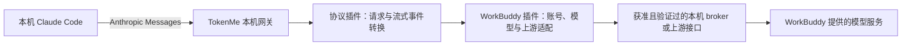

# WorkBuddy → Claude Code 首个候选场景

日期：2026-10-20（Asia/Shanghai）。状态：用户已要求评估本机WorkBuddy供本机Claude Code使用的两种方式，按独立能力设计，建议模型网关优先、任务委派单独验收。本文记录目标、证据和实施票，**没有可运行的TokenMe代理**。关联：[模式评估与委派研究](AGENT_MODES_EVALUATION.md)、[网关设计](AGENT_GATEWAY.md)、[实施规格F13](IMPLEMENTATION_SPEC.md)。

## 1. 两条路径和首个候选目标

| 使用方式 | Claude Code 做什么 | WorkBuddy 做什么 | 出口类型 |
| --- | --- | --- | --- |
| 模型后端（建议优先交付） | 保留自身会话、文件读写/命令执行、审批和工具循环 | 提供经验证可调用的模型能力 | Anthropic Messages 协议插件＋WorkBuddy model_inference provider |
| 任务委派 | 调用一个工具并等待任务结果 | 在获准范围内自行完成整项任务 | 另行限定的工具/MCP 协议出口＋WorkBuddy agent_task provider |

不能把第二条路径返回的任务总结当作第一条路径的模型流。也不能把 Claude Code 发来的 Read/Bash 等工具定义，自动转换成 WorkBuddy 在本机执行工具的指令。模型后端模式下，工具执行者和权限控制者仍为 Claude Code。

模型后端的目标链路：

本机网关表示入口只在本机；WorkBuddy 使用云模型时，请求仍会访问其后端，不宣称离线推理。是否必须保持桌面 WorkBuddy 运行由实际传输决定：走 broker 时必须在线；独立授权 HTTP 路径只有经过验证才允许声明 independent，不暗中切换。

## 2. 当前核验的证据及边界

1. Claude Code 官方文档说明自定义网关可通过 ANTHROPIC_BASE_URL 接入 Anthropic Messages；必须实现 /v1/messages，计数接口可选。流式响应要有完整事件结束，工具调用也须保留语义。来源：[网关协议](https://code.claude.com/docs/en/llm-gateway-protocol)。这证明客户端有入口，不证明 WorkBuddy 上游已适配。
2. Bearer 认证可用 ANTHROPIC_AUTH_TOKEN。接入配置由未来 TokenMe 页面产生，在独立终端/profile验收，不覆盖现有全局 Claude Code 设置或登录。来源：[连接网关](https://code.claude.com/docs/en/llm-gateway-connect)。
3. 现有代码 [WorkBuddy broker](../../crates/usage-quota/src/providers/workbuddy_wbipc.rs) 实现 wbipc 握手和 wb.request/http.fetch 的有界请求，[WorkBuddy quota](../../crates/usage-quota/src/providers/workbuddy.rs)及[国内版](../../crates/usage-quota/src/providers/workbuddy_cn.rs)用于配额/签到。这些静态代码不含可复用为模型代理的完整推理流、工具循环和取消验收。
4. WorkBuddy 国内版官方 Open API 描述了经 OAuth 授权向已连接 PC 助理发消息和读历史；它经过 HTTPS 平台，不是已证明的本机模型监听，也不自动提供模型协议。注册应用和服务端 secret 是该路径的额外接入要求，不能把 secret 内嵌桌面包，也不将其默认为无后端的本地方案。来源：[WorkBuddy Open API](https://open.workbuddy.cn/docs/openapi)。该证据仅属于国内版，不能套用到 WorkBuddy AI 国际版。
5. 同类社区项目文档列出 /v1/messages 到 WorkBuddy/CodeBuddy 上游的转换，可用作待审计的协议线索。未运行、未移植，也未证明本机版本可用；不能直接继承其账号池、自动换号/续期或监听默认值。来源：[workbuddy-gateway 作者文档](https://github.com/CangShui/workbuddy-gateway/blob/main/docs/user-guide.md)。

本机只读检查：Claude Code已安装包版本2.1.266；观察到WorkBuddyAI.exe进程，国内/国际配置目录与IPC描述文件均存在。卸载注册表标识国内5.8.3/国际5.8.4，实际安装资源包5.8.4；静态ACP接口和当前陈旧会话登记见[研究证据](AGENT_MODES_EVALUATION.md)。没有发起模型生成或真实任务。目录/代码存在不证明当前端点或账号可用，不替代G07。

## 3. 插件与平台交付边界

拟议首个包组为可复用的 Anthropic Messages 协议插件，以及 WorkBuddy provider 插件；允许同包交付，注册仍使用两个扩展点。国内 workbuddy_cn 与国际 workbuddy 分别声明 tool/账号/认证/端点/模型目录及授权；同一显示名称不触发合并，禁止自动回退另一个版本或账号。

TokenMe 核心实现通用监听、consumer key、路由与授权、长 IO、短步执行、取消/未知结果、用量接收和统一设置。上游 origin、路径、wbipc 发现/握手、消息/工具/用量映射和模型目录均属插件。第一个 Agent 接入完成后，在同一已实现传输能力内增加其他 provider 应只安装新插件；遇到新 OS/传输服务则演进宿主 profile，不承诺任意接口无需框架升级。

若 wbipc 是必要路径，G03 必须增加通用 broker.session.open/read/write/close 服务：端点来源/所有者与最终 pipe/socket 身份验证、双向流、帧上限、HMAC/凭据证明、取消和超时均受宿主监督。原 broker.request 的单次完整响应不等于流式 broker。ticket 不交给协议插件；握手秘密由绑定的凭据/证明服务使用，算法、域与参数 schema 在 G01 固定。具体 pipe/operation 名称以版本证据确定，不在方案中猜测。

## 4. Claude Code 可用的最低合同

“文本接口能回答”仅是探路，不能标为 Claude Code 适配完成。G01 的首个具体协议必须至少固定下列语义，并以实际客户端请求锁定 schema，而不是把当前草案的简化 Message.text 当作最终类型：

- system 数组/顺序、user/assistant 内容块、工具定义、工具选择、工具调用 ID、参数 JSON、tool_result 与错误状态。不能把结构化内容拍平成一个提示词，也不能为“修复序列”删掉原本有效的工具结果。
- SSE 文本与工具参数增量、块边界、stop reason、usage 和完整结束；heartbeat 与业务进展分别计时，ping 不延长任务硬 deadline，不伪造业务产出。
- model 显式映射、上下文/输出限制、模型是否支持工具。CC 的主/小模型选择都绑定已授权映射，不伪造上游真实模型名、不自动换供应商。
- cache/thinking/experimental 字段和版本头按锁定 profile 逐项验证：同方言透传与异方言转换分开；后者必须明确支持/拒绝，不能删除未知字段后宣称兼容。模型别名不构成“与官方 Claude 完全等价”的承诺。
- count_tokens 没有真实实现时不注册，或明确展示估算口径；不得把字数估算当供应商实测 Token。功能降级必须在客户端设置建议和能力页说明。
- 客户端可能自动重试。插件明确 x-should-retry/错误/Retry-After 映射；已 dispatch 的未知结果不建议重试。无稳定请求/幂等身份时，不能按相同消息正文把两个有意调用自动合并，也不能保证客户端主动重发不会重复计费。

官方文档会随版本变动，G01/G07 记录客户端/Agent 版本、对应资料日期和样本摘要；对新客户端版本重跑合同语料。当前内部通用合同的严格未知字段规则，与具体外部协议处理分层：外部协议插件可更新其版本化解析/映射，但宿主权限、标准类型和预算不能被外部字段改写；新的标准语义须升级扩展合同。

## 5. 实施前探路票 WB-P0

WB-P0步骤1—2是 G01/G04 的可行性前置；步骤3—5在 G01/G02/G03 后随 G04 实现，步骤6随 G05/G07完成，不把后续真实组件验收反过来设为 G01 前置。全程不改动现有 WorkBuddy/Claude Code 登录和全局设置，不新增云端后台。当前未执行真实生成调用。

| 顺序 | 操作与产物 | 通过条件/失败处理 |
| --- | --- | --- |
| 1 身份/版本 | 用户选定 domestic/global；只读确定安装版本与可用机器接口 | 账号/版本/传输归属确定；无法确认不使用另一目录的凭据代替 |
| 2 协议与授权 | 确认模型调用操作、流/工具/取消的机器合同及凭据注入 | 明确是本机 broker、授权 HTTP 还是完整任务 API；没有合适接口则停在可行性缺口，不用 UI 自动点击伪装模型协议 |
| 3 合成上游 | 捕获匿名规范样本，先用 mock 跑文本、工具、流、错误、未知结果 | 验证最终 Wasm 组件＋宿主服务，正文秘密 marker 不进入日志 |
| 4 最小真实调用 | 明确一次有预算的模型调用，按已有会话授权执行；不做价格遍历/自动刷免费模型 | 返回真实模型/usage或明确 unknown；保留安全元数据，不声称完整客户端成功 |
| 5 真实工具往返 | 独立空目录中 Claude Code 发工具调用、在其审批下执行、回传结果，再完成回答 | 工具在 Claude Code 端执行；不让 WorkBuddy 另起一个重复执行者 |
| 6 接收与故障 | 与已有 WorkBuddy/Claude 日志对账，测试中断/取消/账号撤权/升级 | 相同消费只计一次；无法关联标重叠；取消、未知与费用口径真实 |

完整任务委派保留独立WB-D0—D3轨道，见模式评估；上表WB-P0只验模型后端，不替代任务路径的可识别/隔离/取消与权限门。

## 6. 当前结论

架构能够新增这两类插件，Claude Code有模型网关和MCP接入口；**当前TokenMe插件原型与现有适配代码还不能完成这些链路**。先实现F13通用平台并分别通过WB-P0与WB-D0—D3/G04/G07，才能承诺相应能力。模式建议已给出，具体机器接口与全量合同仍须据证据冻结，不能因为找到第三方项目就标为已完成。
